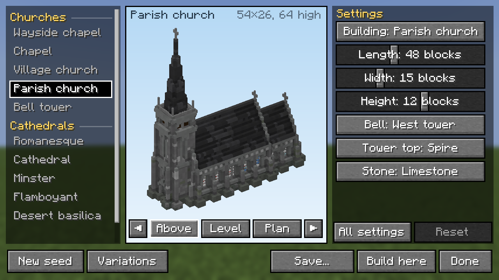
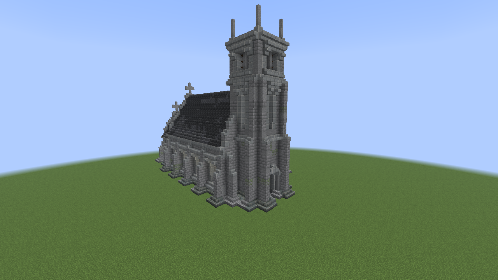
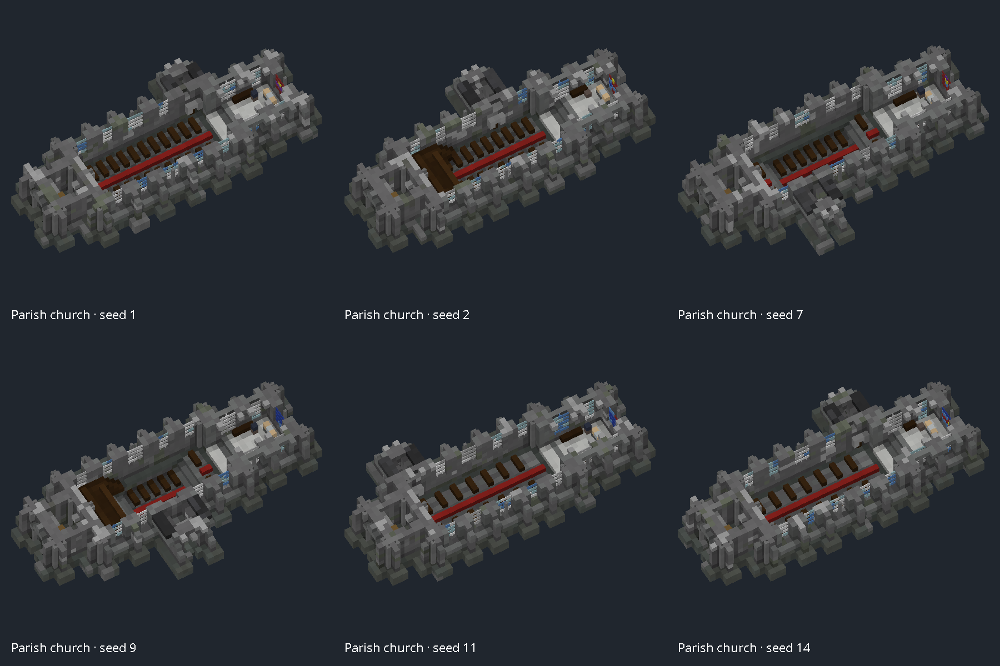
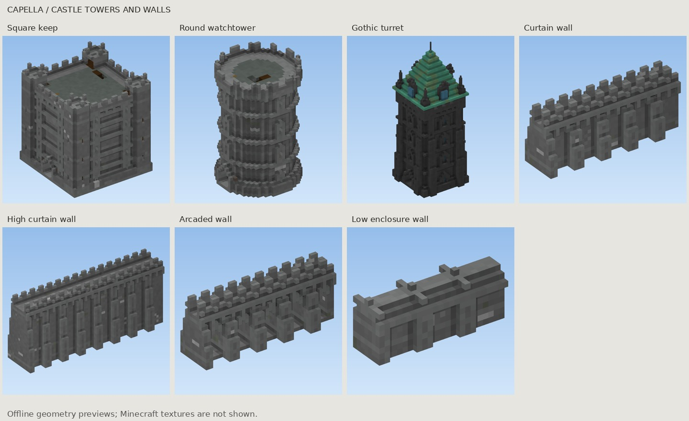
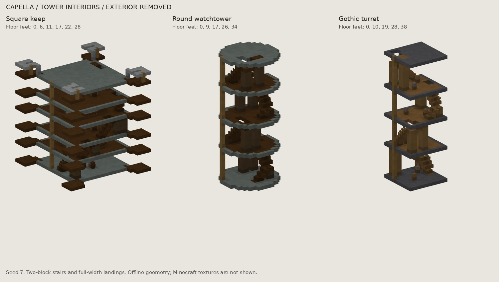

# Capella: gothic church generator for Fabric (Minecraft 26.3)

Generate a wayside chapel, a village church with its west tower, an abbey church, a full cathedral,
a free-standing tower or castle keep, or a stretch of castle wall. Preview it
live in a GUI, then **build it where you stand** or **save it as a schematic** for Axiom,
WorldEdit or 14erEdit.





Small churches (chapel, parish church, bell tower) are built block by block: two-thick walls with
buttresses, a plinth and a cornice, coped gables with crosses, steep roofs, a chancel, a porch, a
bellcote or a staged west tower with a louvred belfry and a bell, and a spire, saddleback or
parapet on top. The seed also chooses the interior: conventional or facing seating, patterned floors,
raised sanctuaries with one to three steps, sunken naves two or three blocks below the doorway,
and west balconies reached by stairs. Compact buildings use arrangements that fit their size.
Porches vary in side, bay, width and depth, while the west door remains the placement origin.



Great towers (west tower, spire tower, belfry) are cathedral-scale and also built block by block:
three-thick walls, stepped angle buttresses rising into pinnacles, stages spaced to the tower width, with more floors as height increases, a deep
stepped portal, a louvred belfry with several bells, and battlements, a needle spire or a
saddleback.

Every building is then dressed by a detail pass (`core/detail/Detailer`) that works on the blocks:
a plinth and pier bases, string courses and capitals, corbel-table cornices, hood moulds, shafts
in re-entrant corners, blind arcading carved one deep into flat walls, quoins and set-off
weatherings. The off-centre stair turret beside a cathedral's west front is now off by default
(*Stair turret* under All settings).

Cathedrals are furnished inside: a stone runner up the nave, pews with transverse passages, a
pulpit and a font, a screen with a loft across the entrance to the choir, stepped choir stalls
under a canopy, the altar on a
dais, low chandeliers, aisle lamps and stone candlestands. Seeded side bays provide quiet reading,
votive and memorial spaces while keeping the main routes open. Switchback stairs at the
west end of the outer aisles climb to guarded galleries, with supported bridges across the
transepts. The galleries are roofed at the clerestory sill, and carved bosses mark where the vault
ribs cross. Furnishings, gallery stairs and bosses can each be turned off under *Interior* in
All settings. An east end with an ambulatory has a ring of walk for
every aisle, vaulted, leaded and glazed, so the aisles run on round the apse.

Abbey churches sit between the two: the cathedral generator on a compact section (one-block arch
rings, three-block galleries and wall passages, slimmer piers and buttresses), so a nave of twelve
to twenty blocks still has an arcade, a gallery with balcony arches onto the nave, a clerestory wall
passage, a vault, and flying buttresses with pinnacles. Single-file switchback stairs climb to the
galleries in the narrower aisles, and the nave hangs single lanterns instead of chandelier rings. They
take the cathedral settings (storeys, transepts, east end, towers, piers, tracery).

Cathedrals use a faithful Java port of the cathedral path of
[Capella](https://github.com/tjhgibbs-git/mc-gothic-generator), fitted to the size you ask for.
The GUI, placement and export code come from
[Sylvan](https://github.com/tjhgibbs-git/tree-generator-fabric).

Castle towers have distinct silhouettes: a broad keep with four full-height octagonal corner
turrets, a round watchtower with a battered plinth and a corbelled fighting crown, and a Gothic
turret with set-off buttresses, leaded pointed windows, pinnacles, gabled dormers and a tall
copper pavilion roof. Recessed portals, hood moulds, projecting stage strings and restrained
stone mixes give each elevation depth. Walls have splayed buttress feet, arch surrounds,
corbel tables, capped merlons and stone coping.





## Using it

Press **H** to open the generator.

- **Presets** (left), in collections you can fold away by clicking their heading (a folded one
  shows how many presets it holds; the folds are remembered): *Churches* (wayside chapel, chapel,
  village church, parish church), *Abbey churches* (Norman priory, collegiate church, abbey
  church), *Cathedrals* (Romanesque, cathedral, minster, flamboyant, desert basilica, great church,
  colossal), *Towers* (bell tower, great west tower, spire tower, belfry, square keep, round
  watchtower, Gothic turret) and *Walls* (curtain wall, high curtain wall, arcaded wall, low
  enclosure wall). Hover a preset for a description.
- **Castle towers and walls** (square keep, round watchtower, Gothic turret; curtain, arcaded and
  enclosure walls). Walls have independent Length (9–160), Width/thickness
  (5–11), Height (5–40) and Wall walk controls. Wall ends have no ladders or access
  structures, so they join cleanly to towers and other wall modules. Towers have Width (13–35),
  Height (12–96) and optional stairs plus a secondary ladder route to the fighting deck.
  Floor spacing sets the approximate storey height (5–12 blocks); Vary floor heights
  redistributes the intervals with the seed while preserving the top deck. Furnishings toggles
  encounter cover, barricades and room lighting. Stair flights and landings keep the same width
  through their exits: two blocks in normal towers, one in compact footprints. Where there is
  room for clear circulation, alternate galleries open firing angles across
  a central shaft, with a narrow guarded bridge and a perimeter stair route. The keep's corner
  turrets have level firing rooms and short climbs to their battlements.
  Height measures to the deck; parapets and roofs rise above it. Wall walks have open ends
  for joining segments. Wall placement starts at the centre of the west end; tower placement
  starts at the west doorway. Stone and seed work as for churches.
- **Preview** (middle): Above / Level / Plan views, and ◀ ▶ to turn the building.
- **Settings** (right): the main settings for the kind of building you have chosen: Building type,
  Length / Width / Height in blocks, then a few choices (bell, tower top, east end, west towers,
  wall towers, gatehouse, stone).
  **All settings** shows everything that applies to that type, grouped, plus the seed.
- **New seed** re-rolls the layout and stone mix. **Variations** shows six versions side by side
  (*Subtle* or *Wild*); click one to use it, right-click to pick several and save them together.
- **Save...** writes native Axiom `.bp` blueprints with thumbnails, `.schem` (WorldEdit),
  14erEdit and/or `.nbt`. Blueprints appear in `config/axiom/blueprints/Capella`.
- **Y − / +** beside Build here adjusts placement by −64 to +64 blocks; scroll over the control
  to change it, or click its value to reset. The offset is remembered between sessions.
- **Build here** (creative only) puts the west door on the block you are looking at, with the
  nave running the way you face. `/capella undo` takes it back. Anything bigger than about
  120×120×120 asks first and suggests saving a `.schem` to paste with Axiom (you can still build it).

Commands:

- `/capella place <preset> [seed]`
- `/capella build <encoded params>`
- `/capella export <preset> <axiom|sponge|structure|14eredit> [seed]`
- `/capella undo`
- `/capella presets`

Buildings are pristine and include no surrounding terrain, ruin or greenery. Sunken interiors
extend below the west-door datum and include explicit excavation air in exports, so those rooms
are cleared when pasted into terrain. Smaller buildings omit balconies or sunken areas when
there is insufficient room. Existing saved parameter strings remain readable; the new seeded
layouts change the result when regenerating a small church.

## Building

```
./gradlew build                                   # everything (needs Fabric maven + Mojang)
./gradlew :core:test -PcoreOnly                   # core only, any JDK 21+, no Minecraft
./gradlew :core:renderPreviews -PcoreOnly         # PNG of every preset -> core/build/previews
./gradlew :core:renderPreviews -PcoreOnly -Ppreset=cathedral -Pseed=7
./gradlew :core:reviewTowers -PcoreOnly           # shell-free tower cutaways, floor plans and height CSV
./gradlew :core:reviewInteriors -PcoreOnly -Ppreset=cathedral,minster -Pseed=1  # -> core/build/interior-review
```

Read [docs/PORTING.md](docs/PORTING.md) before changing anything under `core/`. It covers the
porting conventions and how to regenerate the oracle from the TypeScript.

`reviewInteriors` renders player-eye views of a cathedral's generated blocks, a contact sheet,
floor and gallery clearance maps and a camera CSV. It is an offline geometry check (average block
colours, flat lighting), not a Minecraft screenshot. For a like-for-like before/after, pass the
earlier run's CSV with `-PreviewCameras=<file>` and choose the output with `-PreviewDir=<dir>`.

### Castle garrison additions

The Towers collection also includes **Sentry tower** (`sentrytower`) and **Timber watchtower**
(`timberwatchtower`). These use 7–13 block bodies and heights of 8–32 blocks, with compact
portals and optional ladder access. The stone sentry has a corbelled fighting deck; the timber
lookout has a projecting guarded gallery under a gabled roof. They do not use the large towers'
floor-spacing controls. The listed width is the body: crowns and eaves project beyond it.

The **Garrison** collection adds **Barracks** (`barracks`) and **Stables** (`stables`), with independent
Length (15–65), Width (9–21) and wall Height (5–12) controls. Both have hollow gabled roofs,
stone foundations, timber framing, and three-wide passages with portals at either end.
Furnishings adds bunks and lockers to barracks (single bunks in low halls), and stall partitions,
hay and water troughs to stables. These are structure exports; no horses or other entities spawn.

Castle masonry now follows the storeys rather than arbitrary horizontal stripes. Keeps have
blind-arched wall panels and entrance gables, curtain walls have recessed bays and lower capped
merlons, and Gothic turret roofs have hollow interiors. Existing parameter strings remain valid.

For close inspection of keep windows, run `./gradlew :core:reviewKeepWindows -PcoreOnly`
(optionally `-PreviewDir=<directory>`). This writes close exterior and room-side views, two
successive masonry cutaways, and horizontal sill/opening slices for four keep widths. These
views use the finished generated blocks, including any overlapping stairs and furnishings.
Keep windows now use flush dressed jambs, shallow projecting sills and hoods, and reveals
that widen inward. Larger keeps have paired upper lights with stone mullions; narrower keeps
use single loops sized to fit between the corner drums. Entrance gables stay below upper windows.

### Gatehouses and wall joins

Enable **Gatehouse** on any wall type, or start with the **Square gatehouse**, **Round gatehouse**
or **Roofed gatehouse** wall presets. **Gate towers** selects square, round or roofed flanking
towers; **Gate arch** selects a flat lintel, round arch or pointed arch. **Gate** selects open,
raised portcullis, closed portcullis or closed timber. Gates are static generated blocks, so
select Open or Raised portcullis for a traversable gateway.

The gateway defaults to the centre of the wall, with a 3-, 5- or 7-block passage according to length.
Tower footprints fit the remaining space without extending past the modular wall ends. Very
short walls use compact gate piers; round profiles appear once the towers have enough width.
Low walls reduce the arch rise to preserve at least three blocks of clear height. Wall height
still measures to the wall-walk deck; tower crowns and roofs extend above it. The origin stays
at the centre of the west wall end. Tower chambers have internal floors and ladders where their
size allows, with ground doors off the gate passage. Enabling Wall walk connects the curtain
through both tower chambers and across the gateway; disabling it closes the outer walk doors.

Buttresses now have full-width capitals bonded into the cornice, exposed weathering caps and
continuous supported ledges. The cornice aligns with a gatehouse abutment collar before round
towers curve away. Layered geometry reviews are available with
`./gradlew :core:reviewWallJoins :core:reviewGatehouses -PcoreOnly`.

**Gatehouse position** moves the complete gatehouse along the wall: 0% towards the placement
end, 50% centred, 100% towards the far end. Both towers retain their size and leave a wall-end
column for joining. Short modules with no spare length have no travel. The setting is saved as
`gate_position` (0–1); older parameter strings retain the centred default.

Gothic turret dormers now have recessed cyan panes, pointed heads and a stone mullion, with
open reveals through the roof into the attic. Their gabled caps and cheeks return into the
sloping roof. Use `./gradlew :core:reviewGothicDormers -PcoreOnly` for close and layered views.
