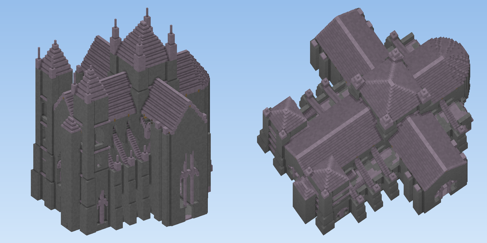
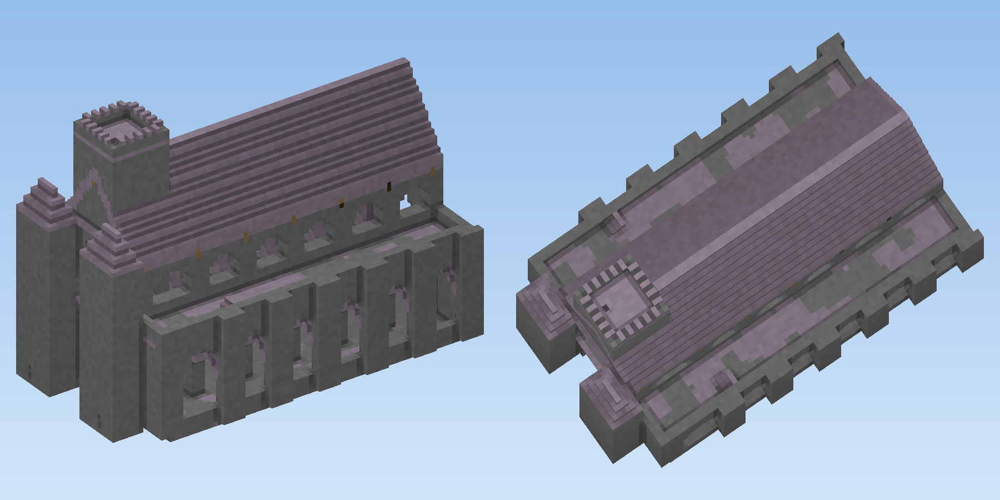

# Capella: gothic church generator for Fabric (Minecraft 26.3)

Generate a parish church, an abbey or a cathedral, preview it live in a GUI, then **build it where
you stand** or **save it as a schematic** for Axiom, WorldEdit or 14erEdit.

The generator is a faithful Java port of the cathedral path of
[Capella](https://github.com/tjhgibbs-git/mc-gothic-generator). The same scene and seed give the
same blocks in both, and a test checks that on seven fixtures. The GUI, placement and export code
come from [Sylvan](https://github.com/tjhgibbs-git/tree-generator-fabric).





## Status

| Part | State |
|---|---|
| `core/`: plan, shell, rasterizer, exporters, preview renderer | 12 JUnit tests green. `OracleTest` matches Capella's elements and every block on 7 fixtures |
| `fabric/`: GUI, placement, networking, commands, GameTests | Written against the core API. **Not yet built**: the cloud session had no access to `maven.fabricmc.net` |

See [docs/HANDOFF.md](docs/HANDOFF.md) for what to do next.

## Using it

Press **H** to open the generator.

- **Presets** (left column): chapel, parish, abbey, cathedral, minster, deepslate cathedral,
  desert basilica, great cathedral, colossal.
- **Preview** (middle column): Above / Level / Below views, plus ◀ ▶ for quarter turns.
- **Settings** (right column): the main settings by default. **All settings** shows plan,
  elevation, towers, style and stone.
- **New seed**, **Variations**, **Save...** and **Build here** work as they do in Sylvan.
- **Build here** builds the church with its west door on the block you are looking at. The nave
  runs the way you face. Undo it with `/capella undo`.

Commands:

- `/capella place <preset> [seed]`
- `/capella build <encoded params>`
- `/capella export <preset> <sponge|structure|14eredit> [seed]`
- `/capella undo`
- `/capella presets`

What it builds is pristine and stands on no ground. There is no footing, terrain, crypt, ruin or
greenery. That is a decision, not a gap; see the handoff.

## Building

```
./gradlew build                                   # everything (needs Fabric maven + Mojang)
./gradlew :core:test -PcoreOnly                   # core only, any JDK 21+, no Minecraft
./gradlew :core:renderPreviews -PcoreOnly         # PNG of every preset -> core/build/previews
./gradlew :core:renderPreviews -PcoreOnly -Ppreset=cathedral -Pseed=7
```

Read [docs/PORTING.md](docs/PORTING.md) before changing anything under `core/`. It covers the
porting conventions and how to regenerate the oracle from the TypeScript.
