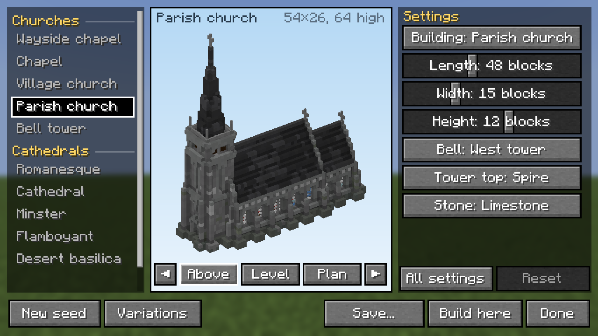
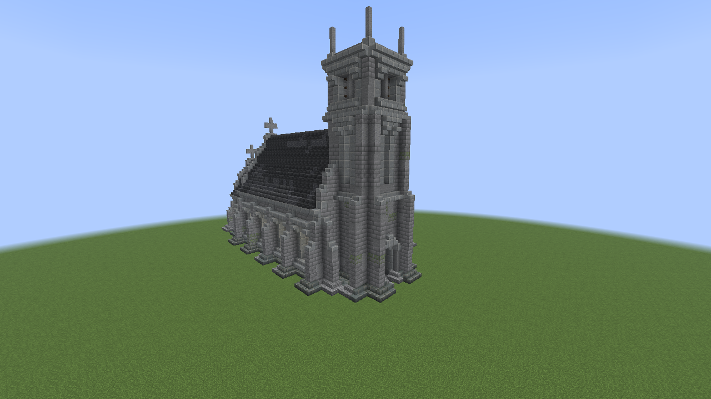
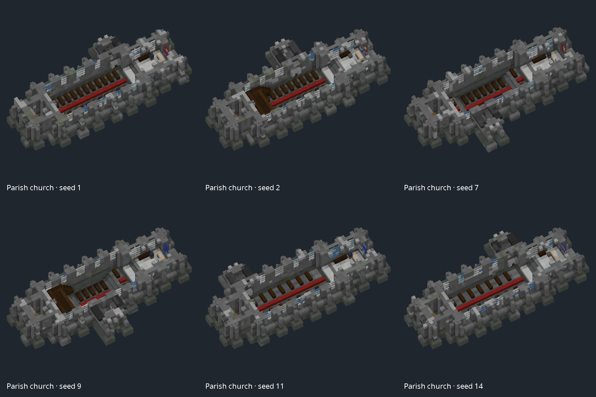

# Capella: gothic church generator for Fabric (Minecraft 26.3)

Generate a wayside chapel, a village church with its west tower, or a full cathedral. Preview it
live in a GUI, then **build it where you stand** or **save it as a schematic** for Axiom,
WorldEdit or 14erEdit.





Small churches (chapel, parish church, bell tower) are built block by block: two-thick walls with
buttresses, a plinth and a cornice, coped gables with crosses, steep roofs, a chancel, a porch, a
bellcote or a staged west tower with a louvred belfry and a bell, and a spire, saddleback or
parapet on top. The seed also chooses the interior: conventional or facing seating, patterned floors,
raised sanctuaries with one to three steps, sunken naves two or three blocks below the doorway,
and west balconies reached by stairs. Compact buildings use arrangements that fit their size.
Porches vary in side, bay, width and depth, while the west door remains the placement origin.



Great towers (west tower, spire tower, belfry) are cathedral-scale and also built block by block:
three-thick walls, stepped angle buttresses rising into pinnacles, stages spaced to the tower width, with more floors as height increases, a deep
stepped portal, a louvred belfry with several bells, and battlements, a needle spire or a
saddleback.

Every building is then dressed by a detail pass (`core/detail/Detailer`) that works on the blocks:
a plinth and pier bases, string courses and capitals, corbel-table cornices, hood moulds, shafts
in re-entrant corners, blind arcading carved one deep into flat walls, quoins and set-off
weatherings. The off-centre stair turret beside a cathedral's west front is now off by default
(*Stair turret* under All settings).

Cathedrals are furnished inside: a stone runner up the nave, pews with transverse passages, a
pulpit and a font, a screen with a loft across the entrance to the choir, stepped choir stalls
under a canopy, the altar on a
dais, low chandeliers, aisle lamps and stone candlestands. Seeded side bays provide quiet reading,
votive and memorial spaces while keeping the main routes open. Switchback stairs at the
west end of the outer aisles climb to guarded galleries, with supported bridges across the
transepts. The galleries are roofed at the clerestory sill, and carved bosses mark where the vault
ribs cross. Furnishings, gallery stairs and bosses can each be turned off under *Interior* in
All settings. An east end with an ambulatory has a ring of walk for
every aisle, vaulted, leaded and glazed, so the aisles run on round the apse.

Cathedrals use a faithful Java port of the cathedral path of
[Capella](https://github.com/tjhgibbs-git/mc-gothic-generator), fitted to the size you ask for.
The GUI, placement and export code come from
[Sylvan](https://github.com/tjhgibbs-git/tree-generator-fabric).

## Using it

Press **H** to open the generator.

- **Presets** (left): *Churches* (wayside chapel, chapel, village church, parish church, bell
  tower) and *Cathedrals* (great west tower, spire tower, belfry, Romanesque, cathedral, minster, flamboyant, desert basilica, great
  church, colossal). Hover a preset for a description.
- **Preview** (middle): Above / Level / Plan views, and ◀ ▶ to turn the building.
- **Settings** (right): the main settings for the kind of building you have chosen: Building type,
  Length / Width / Height in blocks, then a few choices (bell, tower top, windows, stone).
  **All settings** shows everything that applies to that type, grouped, plus the seed.
- **New seed** re-rolls the layout and stone mix. **Variations** shows six versions side by side
  (*Subtle* or *Wild*); click one to use it, right-click to pick several and save them together.
- **Save...** writes native Axiom `.bp` blueprints with thumbnails, `.schem` (WorldEdit),
  14erEdit and/or `.nbt`. Blueprints appear in `config/axiom/blueprints/Capella`.
- **Y − / +** beside Build here adjusts placement by −64 to +64 blocks; scroll over the control
  to change it, or click its value to reset. The offset is remembered between sessions.
- **Build here** (creative only) puts the west door on the block you are looking at, with the
  nave running the way you face. `/capella undo` takes it back. Anything bigger than about
  120×120×120 asks first and suggests saving a `.schem` to paste with Axiom (you can still build it).

Commands:

- `/capella place <preset> [seed]`
- `/capella build <encoded params>`
- `/capella export <preset> <axiom|sponge|structure|14eredit> [seed]`
- `/capella undo`
- `/capella presets`

Buildings are pristine and include no surrounding terrain, ruin or greenery. Sunken interiors
extend below the west-door datum and include explicit excavation air in exports, so those rooms
are cleared when pasted into terrain. Smaller buildings omit balconies or sunken areas when
there is insufficient room. Existing saved parameter strings remain readable; the new seeded
layouts change the result when regenerating a small church.

## Building

```
./gradlew build                                   # everything (needs Fabric maven + Mojang)
./gradlew :core:test -PcoreOnly                   # core only, any JDK 21+, no Minecraft
./gradlew :core:renderPreviews -PcoreOnly         # PNG of every preset -> core/build/previews
./gradlew :core:renderPreviews -PcoreOnly -Ppreset=cathedral -Pseed=7
./gradlew :core:reviewInteriors -PcoreOnly -Ppreset=cathedral,minster -Pseed=1  # -> core/build/interior-review
```

Read [docs/PORTING.md](docs/PORTING.md) before changing anything under `core/`. It covers the
porting conventions and how to regenerate the oracle from the TypeScript.

`reviewInteriors` renders player-eye views of a cathedral's generated blocks, a contact sheet,
floor and gallery clearance maps and a camera CSV. It is an offline geometry check (average block
colours, flat lighting), not a Minecraft screenshot. For a like-for-like before/after, pass the
earlier run's CSV with `-PreviewCameras=<file>` and choose the output with `-PreviewDir=<dir>`.
