# Quality pass: fixes to the small buildings and the generator screen

Written 2026-11-16 from a review of the small presets (churches, walls, gatehouses, towers,
bridges, garrison buildings) and the generator screen. The large churches and cathedrals were
deliberately left out and are out of scope here too.

This is a plan for a fresh session to execute. Read the whole of "How to work" before starting on
the items.

## What the owner cares about

The buildings that get used most are the walls, bridges, towers and small churches, and several of
them look clunky in the game. The aim of this pass is that each of them looks right when you stand
next to it, not that it passes tests. Judge every change in in-game screenshots, including
close-ups, undersides and cutaways.

Standing preferences, from earlier reviews:

- Fence blocks read as clunky. Use walls, trapdoors, slabs, stairs, logs or chains instead, or
  leave the prop out. A floating bunk was preferred to one framed with fence posts.
- Chains, not iron bars, for hangers and suspension. A portcullis may stay iron bars.
- Never put a lantern partway up a chain or post, and never stand one on a floor. If there is no
  good place for a light, leave it out.
- Tower tops must be mirror-symmetric on every face: all four corners alike.
- Undersides are judged too. A flat plain soffit reads as bad.
- Looks matter more than strict traversability, but every storey must stay reachable (tests check).

## How to work

### Constraints

- Read `docs/PORTING.md` before changing anything under `core/`. The cathedral generator is a
  faithful port checked against an oracle; nothing in this plan should touch
  `core/.../cathedral`, `kit` or `detail/Detailer` behaviour for cathedrals. If a fix needs a
  Detailer change, gate it on the small-building path.
- Saved parameter strings must keep decoding. Do not rename or remove params or enum values; add
  new ones with defaults that reproduce today's meaning where practical.
- All four stones (limestone, deepslate, sandstone, blackstone) must look right. A fix checked
  only in limestone is not checked.
- Work on a branch off `26.3`, not on `26.3` itself. Commit per item or per small group of
  related items so each can be reviewed and reverted alone.

### Build and test

```
export JAVA_HOME=/home/tjhgi/.local/jdk/jdk-25.0.5+8 PATH=$JAVA_HOME/bin:$PATH
./gradlew :core:test -PcoreOnly                 # must stay green after every item
./gradlew :core:renderPreviews -PcoreOnly -Ppreset=curtainwall   # quick offline look, not a verdict
```

The tests that guard these generators: `FortificationTest`, `GatehouseTest`, `BridgeTest`,
`GarrisonTest`, `TowerTraversalTest`, `PorchAccessTest`, `KeepWindowTest`, `GothicDormerTest`,
`BuildingGeneratorTest`, `ParamFuzzTest`. Where a test pins geometry that an item deliberately
changes (merlon positions, buttress cells), update the test to the new intent and say so in the
commit; do not weaken a test that checks reachability or clearances.

### Seeing the result in the game

The capture tool is `shots/review.py`. `shots/` is git-ignored, so it exists only in this
checkout; do not work in a fresh clone or worktree without copying `shots/` across. It also needs
`core/.../preview/ShotGeometry.java` and the `shotGeometry` task in `core/build.gradle`, which were
uncommitted when this plan was written: commit them first.

```
bash shots/fresh.sh                                       # start the client in a flat world (minutes)
python3 shots/review.py curtainwall --cutaway --out <dir> # ~35 shots, labelled contact sheets
python3 shots/review.py "<encoded params>" --name x --out <dir>
python3 shots/review.py village --cutaway --cameras <before>/village/cameras.json --out <after>
```

Each building gets `sheet-NN-<group>.jpg` (groups: quarter-high, quarter-eye, elev, crown, roof,
base, deck, under, interior, cut-long, cut-cross), full-size PNGs in `png/`, and a `cameras.json`.
Passing `--cameras` from the "before" run gives identical views for a before/after pair. Other
flags: `--seed`, `--only q-,elev-`, `--bright` (for dark interiors), `--elevate N`, `--dry`.
North is -Z, so the entrance end is the north face.

Two cautions from the review run:

- The machine has about 7.7 GB of RAM. The client plus a leftover Gradle daemon exhausted it and
  the client died mid-batch. Before a capture run, check `pgrep -fa java` and kill stale Gradle
  daemons; capture a few buildings at a time, not all thirty.
- The tool's interior cameras, `under-along` on solid-pier bridges, and eye-level quarters on very
  tall towers are the least reliable shots. Look at what you got before trusting it.

### Loop for each item

1. Capture "before" for the affected presets (keep the `cameras.json`).
2. Make the change. Run the core tests.
3. Capture "after" with the same cameras. Read the sheets: elevations, crown, base and, where
   there is an interior, a cutaway. Check at least one second seed and one second stone.
4. If it does not look clearly better, keep going or back it out. Do not keep a change because it
   was work.
5. For the items marked *offline only*, step 1 is also the confirmation: if the in-game shots
   show the problem is not real, drop the item and note that.

Put the before/after pairs worth keeping in `docs/reviews/quality-pass/` and list them in the PR
description, as earlier review PRs did (`docs/reviews/sentry-bridges.md`).

## Phase 1: walls

Walls are the most-used module and have the worst single defect. Code: `small/Fortification.java`
(`wall()` at about line 612, `wallButtressReach`), `kit/WallWalk.java`, `small/CastleGatehouse.java`.

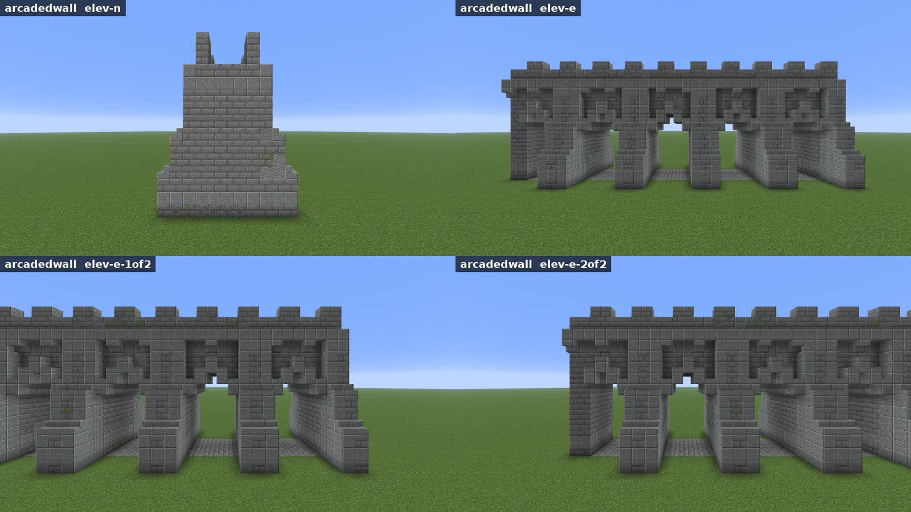

**1.1 Arcaded wall arches.** The arch heads are stepped lumps with stray block clusters in the
spandrels, over openings about three wide between three-wide piers; nothing reads as a pointed
arch. Rebuild the arcade with the struck-arch construction `small/GothicBridge.java` already has
(`layoutArches`, `open`, `order`), with stair and slab voussoirs and clean spandrels. Widen the
openings so the arch has room: an opening of five or more with piers of two or three. Done when
the elevation shows a clear run of pointed arches at lengths 24, 40 and 80 and heights 8, 12 and
20.

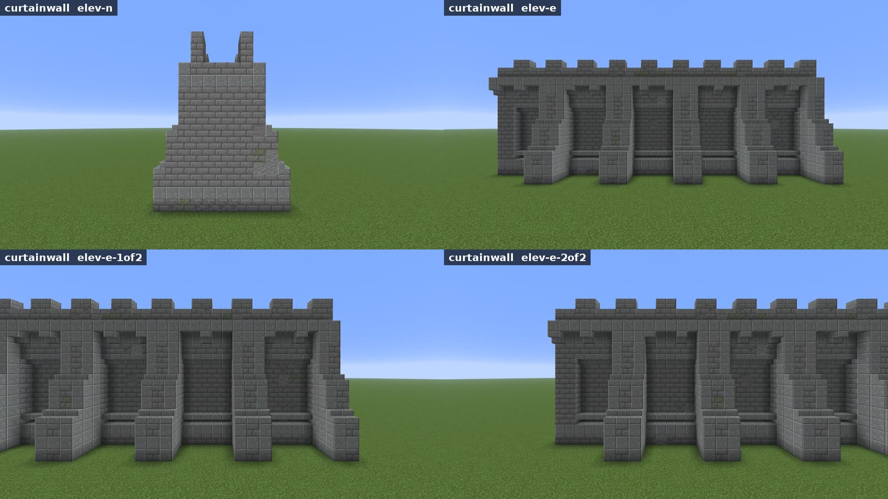
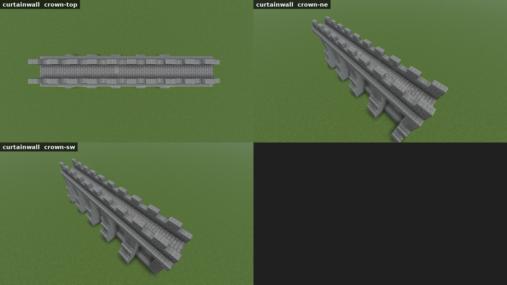

**1.2 One-sided buttressing and parapet.** Curtain, high and arcaded walls carry the same stepped
buttresses and the same battlements on both faces, so a five-thick wall has an eleven-wide
footprint and no field side or court side. Buttress the outer face only. On the inner face use a
plain low parapet (one block, or a slab coping) so the wall walk reads as a walk behind a
battlement. Decide which face is "outer" from the placement convention and state it in the preset
tooltip. Check `FortificationTest` and the wall-walk clearance tests.

**1.3 Wall ends.** Each end finishes in a half buttress that steps down like a ramp, and the top
corbel course juts one block beyond the end. Both collide with a tower or the next module. End
the module flush on both faces and at the crown. Verify by placing two walls end to end and a wall
against a square keep, and shooting the joint (`./gradlew :core:reviewWallJoins -PcoreOnly` gives
an offline first look).

**1.4 Bay panels.** The recessed bays between buttresses end in an "M"-shaped double-notch head
with a slab bench at the foot. Replace the head with a simple pointed or segmental blind arch, or
leave the bay as a plain recess; remove the bench. The high wall needs something to break its
height (a string course at the walk level of the ordinary curtain, or a second tier of panels)
rather than the same panel stretched.

**1.5 Gatehouses (offline only: confirm in game first).**

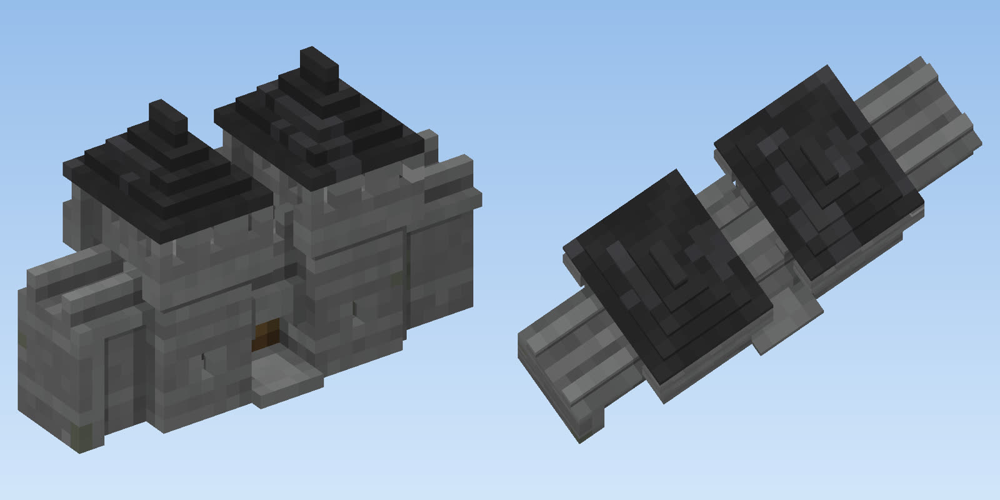

Gate towers appear to rise only two or three blocks above the wall, the gateway is three wide, and
on the roofed variant the two pyramid roofs' eaves nearly touch over the gate. If confirmed: raise
the towers a full storey above the wall walk, widen the gate passage to five where the length
allows, and pull the roofed eaves in or separate the towers. Presets: `gatehouse`,
`roundgatehouse`, `roofedgatehouse`. Also capture `plainwall`, which was not reviewed in game.

## Phase 2: small churches

Code: `small/SmallChurch.java`. Method names below are where to start, with approximate lines.

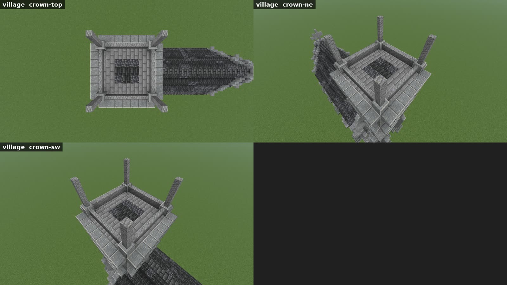

**2.1 Pinnacles.** `parapet` (about 1022) puts a single wall-block post, three or more high, on
each tower corner: they read as antennas. The same form appears on the bell tower and the great
towers (`small/GreatTower.java`, about 247 and 389; offline only there). Replace with a short
stepped pinnacle (a block, a stair cap and one finial block) or omit pinnacles on towers under
about nine wide. Keep all four corners identical.

**2.2 Village tower battlements.** The preset says "battlemented west tower"; the top is a flat
slab rim plus the four posts. Give the parapet real merlons (two wide, one-block crenels, symmetric
about each face's centre for odd and even widths).

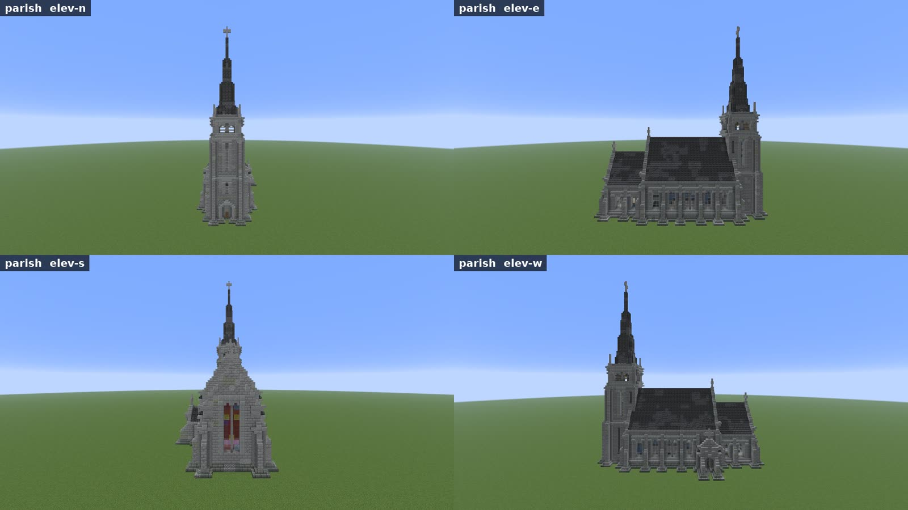

**2.3 Parish spire.** `spire` / `inSpire` (about 1043–1085). The spire is described as a broach
spire but thins to one block for its top third and ends in a long post and cross. Widen the
taper so it does not reach one block until the last two or three courses, add broaches at the
foot so it meets the square tower, and shorten the finial. Check heights from the slider's
minimum to maximum.

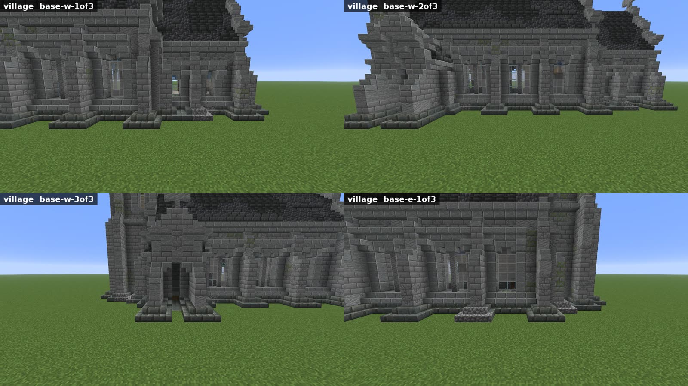

**2.4 Ground line.** `buttress` (about 399) and `plinth` (about 1085). Every buttress has its own
spread slab foot, so the plinth is a row of separate "toes" with gaps between them. Run one
continuous plinth course round the building, buttresses included, and let buttresses rise from
it without a wider foot of their own.

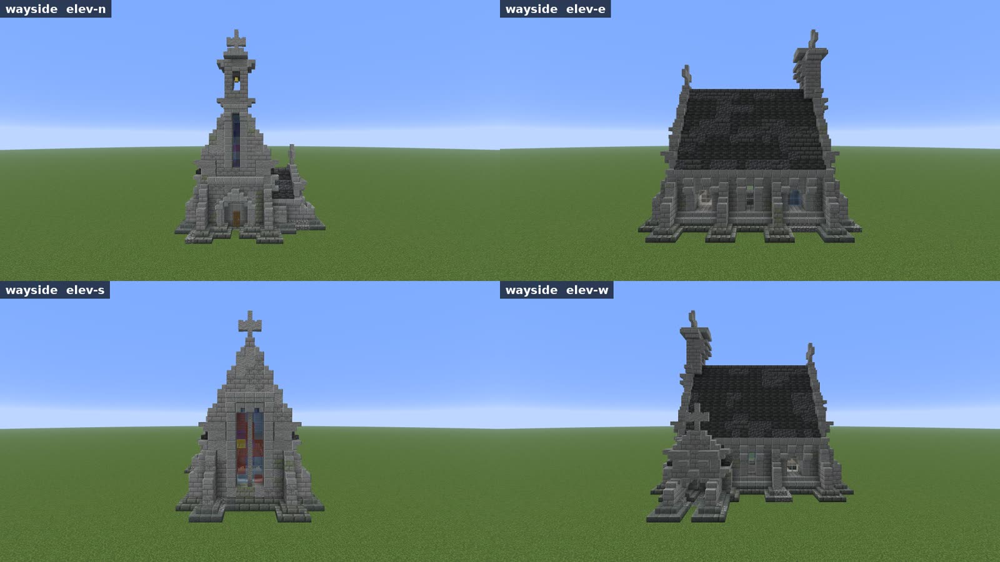
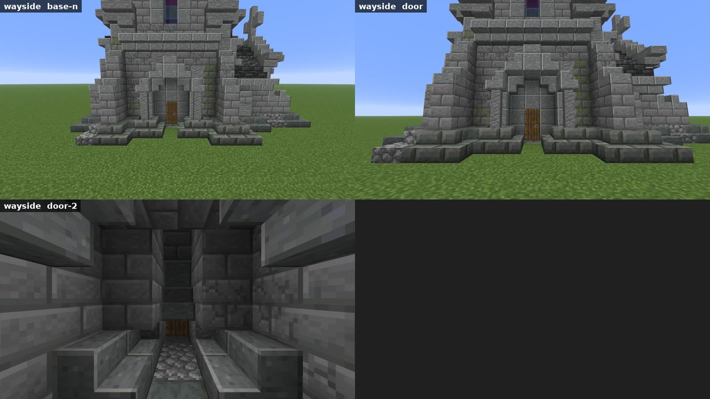

**2.5 Detail scaled to size.** The nine-wide wayside chapel carries diagonal corner buttresses,
a buttress at every bay, a porch, hood moulds, a string course and a cornice; almost no plain wall
is left, and the door sits in a deep portal squeezed between two buttress piers. Scale the
dressing in `dressSides`, `westFront` and `portal` to the width: under about eleven wide, corner
buttresses only, one moulding course, and a shallower portal with clear wall either side.

**2.6 Porch.** `porch` (about 806). The gable reaches most of the wall height, its cross is as
large as the main gable crosses, and the raking coping is jagged. Cap the porch ridge at about
two-thirds of the eaves height, use a one-block finial, and smooth the coping (stairs, not
alternating full blocks). Seen on wayside, chapel and village. `PorchAccessTest` must still pass.

**2.7 Bellcote.** `bellcote` (about 618). It is three deep with an overhanging cap and corbels
out on one side only, so it looks lopsided from the side. Make it a thin gabled wall, symmetric
in both elevations, with the bell in an arched opening.

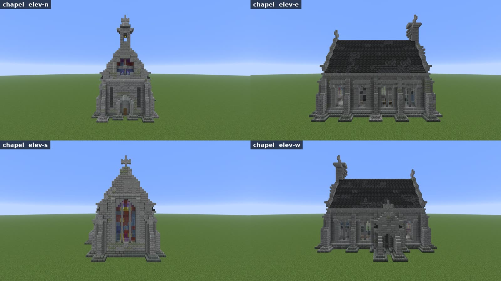

**2.8 Windows along a wall.** Adjacent bays on one elevation get different window forms and
different glass. Choose one form and one glass mix per elevation (the east window and the west
front may differ).

**2.9 Chapel west front.** `rose` (about 599) and `westFront`. The "rose" is a 3×3 cross-shaped
square, and two tall unglazed black slits flank the door. Make the rose read as round (or a
quatrefoil) at radius 1 and 2, and glaze the slits or turn them into shallow blind lancets.

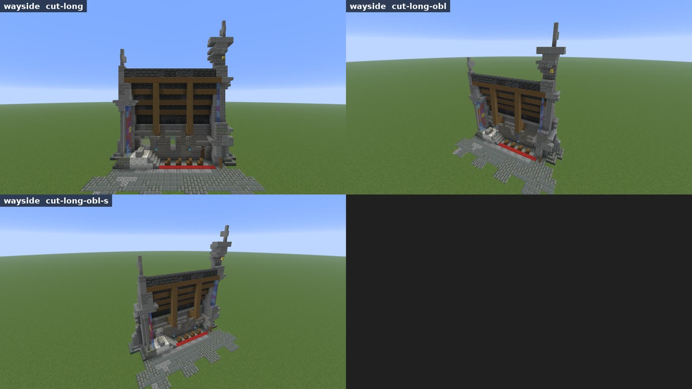

**2.10 Roof trusses.** `trusses` (about 788). King posts drop to head height with a lantern on
the bottom, and log brackets stick out of the walls with nothing on them. Keep every truss member
at or above the wall plate; hang lanterns on chains from the tie beam only where the chain is
short, otherwise leave them out.

**2.11 Material patching.** `small/Style.java` (about 145–170). The roof mix is 25% cobbled
deepslate laid in clusters, and the plinth mix includes cobblestone; in the game both read as
damage, not weathering. Cut those weights to a few percent or scatter single blocks, for every
stone's mixes. This also affects the keep's plinth.

## Phase 3: towers

**3.1 Keep top symmetry.** `small/Fortification.java`: `keepTurrets` (about 336), `cone`,
`keepRoof` (about 453).

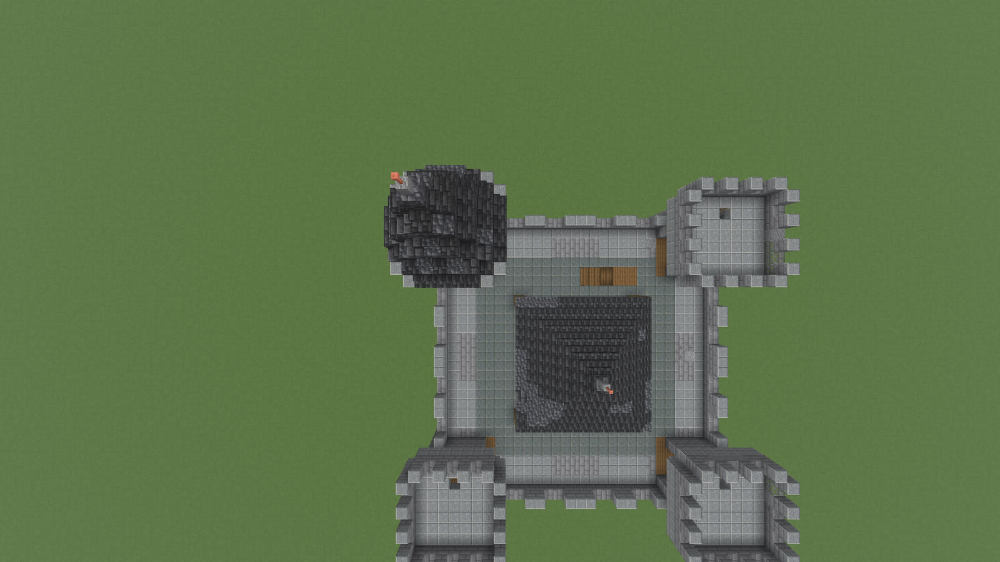

One corner turret has a conical roof and the other three are battlemented, and the central roof's
apex and finial sit off-centre. Make all four turrets alike (all battlemented by default; a
roofed-turrets option may roof all four) and centre the roof and its finial for odd and even
widths.

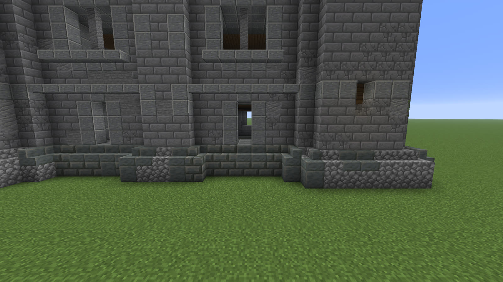

**3.2 Keep windows.** `keepWindows` (about 262), `keepPilasters`. Every opening has a projecting
sill slab, a lintel slab and pilasters, which stack into a grid of ledges up the face, and
ground-floor openings give a view straight through the building. Reduce to a flush dressed
surround with at most one projecting element, and bar or narrow the ground-floor openings. Use
`./gradlew :core:reviewKeepWindows -PcoreOnly` and `KeepWindowTest`.

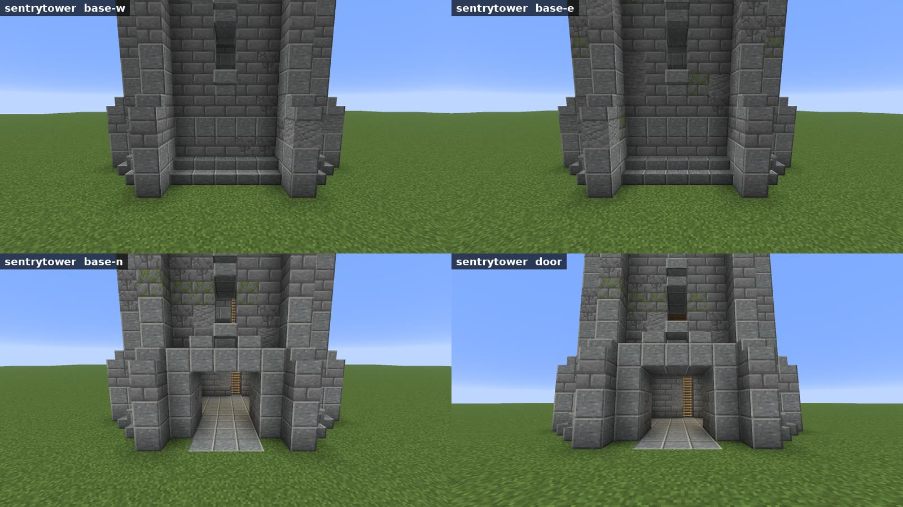
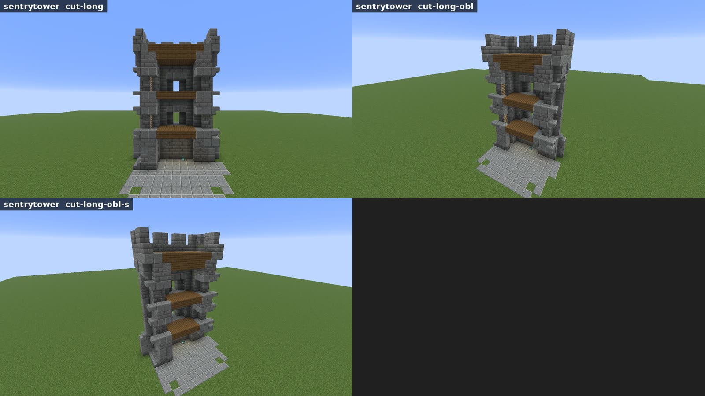

**3.3 Sentry tower.** `small/Garrison.java` (`tower`, `sentryMasonry`). The room is 3×3 inside
three-thick walls on a nine-wide body; the entrance is a three-wide flat-lintel tunnel with no
door; a lantern stands on the ground floor; the stair-block batter at the corners is fussy. Thin
the walls to two so the room is 5×5, give the entrance an arch and a door, remove the floor
lantern, and simplify the base to a single battered course. Check widths 7 to 13.

**3.4 Fences.** Replace every use of `timberFence` with something that is not a fence:

- timber watchtower gallery rail, `Garrison.java:95`;

  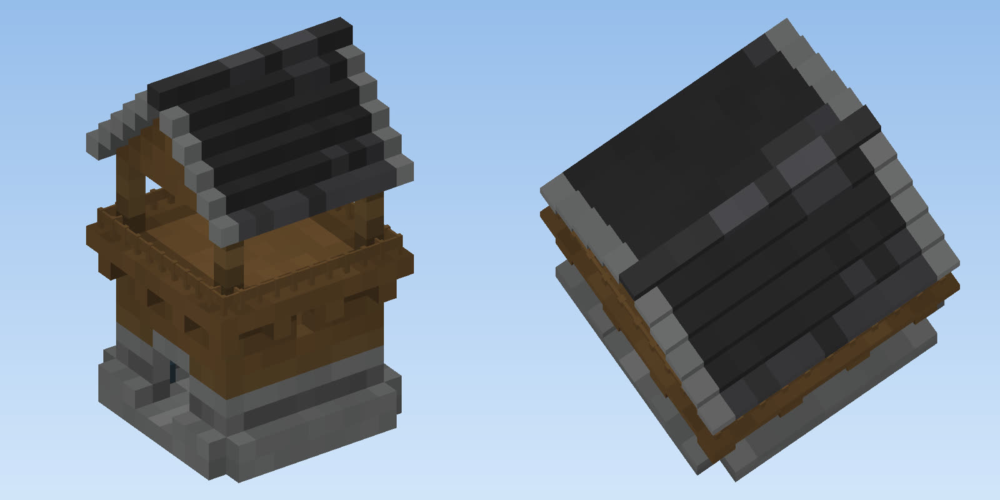

- stables posts and rails, `Stables.java:107, 159, 183, 233, 261` (and the fence gate at 230);
- barracks stair rails, `Barracks.java:301, 304`;
- tower interiors, `TowerInterior.java:140, 265`.

Rails can be trapdoors, slabs on posts of wall blocks, or a low solid plank wall; posts can be
logs or stripped logs.

**3.5 Floor lanterns.** `TowerInterior.java:214`, `Garrison.java:134`, `Fortification.java:310`
stand lanterns on floors. Hang them from the ceiling directly (no long chain) or remove them.

**3.6 Offline only: confirm in game first.** Capture `roundwatchtower`, `gothicturret`,
`timberwatchtower`, `tower`, `westtower`, `spiretower`, `belfry`, then:

- round watchtower: merlons look unevenly spaced round the circle (`roundCrown`, about 484);
- Gothic turret: dormers look off-centre on their faces (`gothicDormers`, about 557;
  `./gradlew :core:reviewGothicDormers -PcoreOnly`);
- great towers: the pinnacle rods from 2.1.

## Phase 4: bridges and garrison buildings

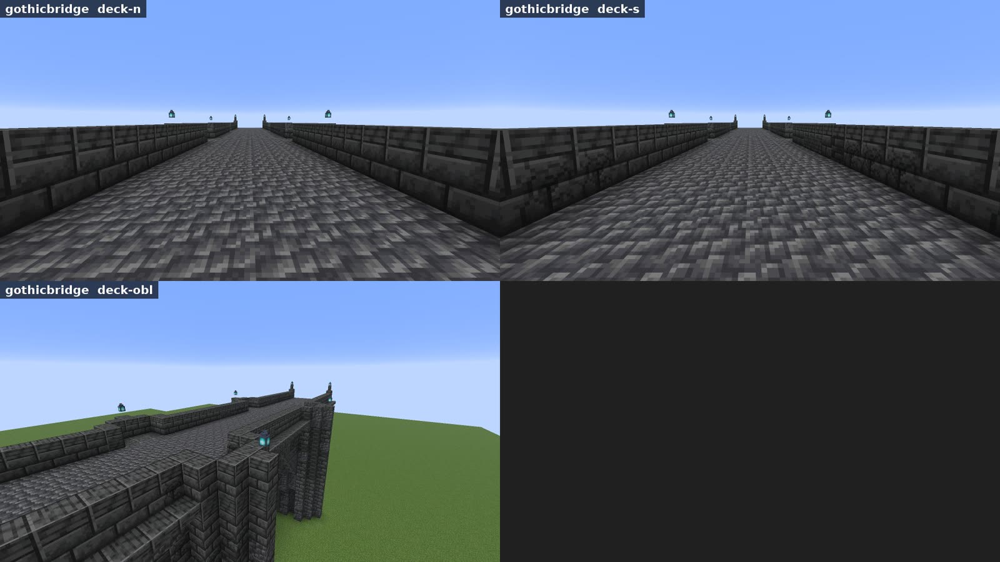

**4.1 Gothic bridge deck and abutments.** `small/GothicBridge.java` (`deck` about 339, `parapet`
about 374). The deck is one flat texture between plain two-high parapets, and the abutment end
faces are large blank slabs. Add a kerb or a centre strip in a second block, a coping on the
parapet, and panel or batter the abutment faces. The stone viaduct deck (`small/Bridge.java`) has
the same plainness.

**4.2 Offline or earlier shots only: confirm in game first.** Capture the other seven bridges and
`barracks`, `stables`, then:

- timber trestle: diagonal braces made of stairs read as a jagged tangle; use straight log knee
  braces (`small/Bridge.java`);
- Tudor footbridge: a lamp on a post at each of the four ends reads as a lollipop; put the lamps
  on the parapet piers or remove them;
- stables: walls, roof and posts are all one dark timber; give the roof a contrasting material.

## Phase 5: generator screen

Code: `fabric/src/client/.../GeneratorScreen.java`, `ParamWidgets.java`, `BuildingViews.java`;
strings in `fabric/src/main/resources/assets/capella/lang/en_us.json`; param definitions in
`core/.../params/Params.java` and `Presets.java`. Verify with block-scraper (`../block-scraper`,
see its `AGENTS.md`): open the screen with key H, shoot at 1280×720 and 854×480, and hover for
tooltips. These points came from the code and older screenshots, not a live session, so look
before changing.

**5.1 Wording.** The title and key binding say "Church Generator". The Build here tooltip speaks
of the west door and nave for walls and bridges. The Y-offset tooltips say "sinks the church", and
`capella.tooltip.place_sunk` / `place_raised` say "The trunk base goes %s blocks lower/higher", a
leftover from the tree mod. Make the wording neutral ("building", "its entrance") or per group.

**5.2 Stale descriptions.** `capella.preset.barracks.desc` and `capella.preset.stables.desc` in
the language file override the newer text in `Presets.java` with descriptions of the old
buildings. Bring the language file in line, and check the other presets for the same drift.

**5.3 Bridge sliders.** "Heading (x 22.5°): 3" should show degrees or a compass point (67.5°,
ENE). "Slope (%): 0" should read "Slope: 0%".

**5.4 Gatehouse rows.** A wall's basic settings show Gatehouse position, Gate towers, Gate arch
and Gate even when Gatehouse is off (`Params.basic`, `Params.applies`). Hide them until it is on.

**5.5 Tooltips on settings.** No setting has a tooltip (`ParamWidgets.create`). Add
`capella.param.<key>.desc` strings and show them, at least for Access, Vary floor heights, Floor
spacing, Walkways, Cutwaters, Upper tier height, Wall walk, Lighting and Windows.

**5.6 Height label.** The Height slider and the size line disagree (28 against 53 high for the
keep) because the slider measures to the eaves or deck. Label it per type: Eaves height, Deck
height, Wall height.

**5.7 Building button.** "Building: X" cycles through twenty types and resets the sizes on every
click; it duplicates the preset list. Make it a read-only label, or remove it from the basic list.

**5.8 Preview.** Three angles and four turns only (`BuildingViews`). Add a straight-on elevation
and eight turns; a cutaway view would help judge interiors if it is cheap.

**5.9 Fallback title.** The preview title falls back to the raw preset id when a translation is
missing (`extractSingle`); fall back to the preset's name.

## Suggested order and stopping points

1. Commit the capture tooling, then Phase 1 (walls). Stop and show before/after.
2. Phase 2 (churches): 2.1–2.4 first, since they affect every church; then 2.5–2.11.
3. Phase 3 (towers), confirming the offline items as you capture.
4. Phase 5 (screen) is independent and small; it can go in its own PR at any point.
5. Phase 4 last.

Each phase is a sensible PR on its own. At the end, re-render the README images that show changed
buildings (`docs/images/village.png`, `castles.jpg`, `gui.png`) and update the README text where
a description no longer matches.

## What was and was not looked at

Seen in the game with the capture tool: wayside chapel, chapel, village church, parish church,
curtain wall, high curtain wall, arcaded wall, sentry tower, Gothic bridge; the square keep
exterior only (no interior or cutaway). Everything else was judged from the offline renderer
(`core/build/previews`) or from in-game shots taken for earlier PRs, and is marked as such above.
The generator screen was reviewed from its code and older screenshots.
