# Houses: in-game review

All images are from a Minecraft 26.3 client with vanilla textures. They were shot with `shots/review.py`, seed 1, furnishings on.

## Medieval townhouse

The ground storey is stone, with the shop window and door under a one-block jetty on carved brackets. Above it is a timber-framed chamber floor and a steep slate roof with its gable to the street. The posts stand on a four-block grid, so every window is centred in its bay and lines up with the window below. Both long sides have windows. The chimney rises through the ridge at the rear gable.

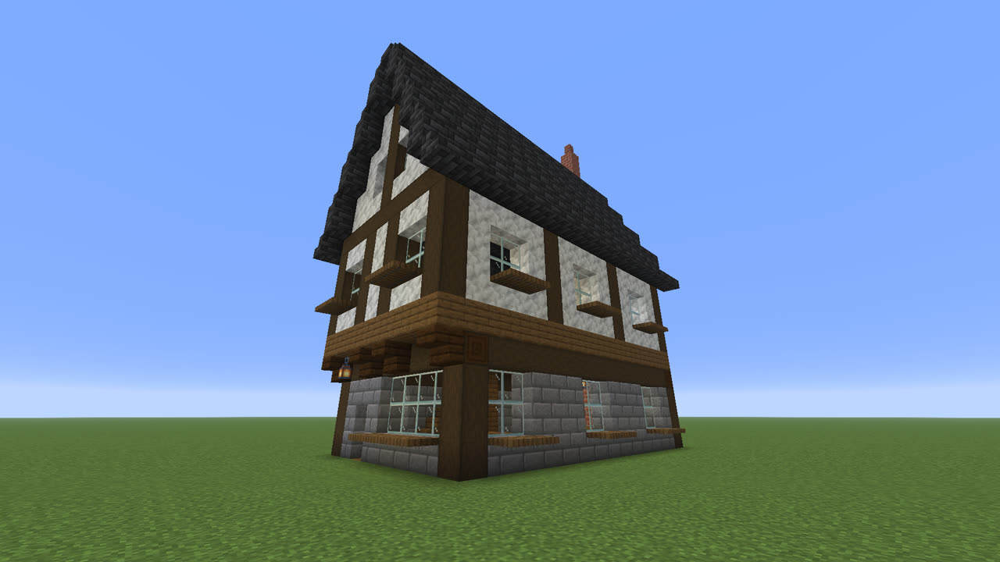
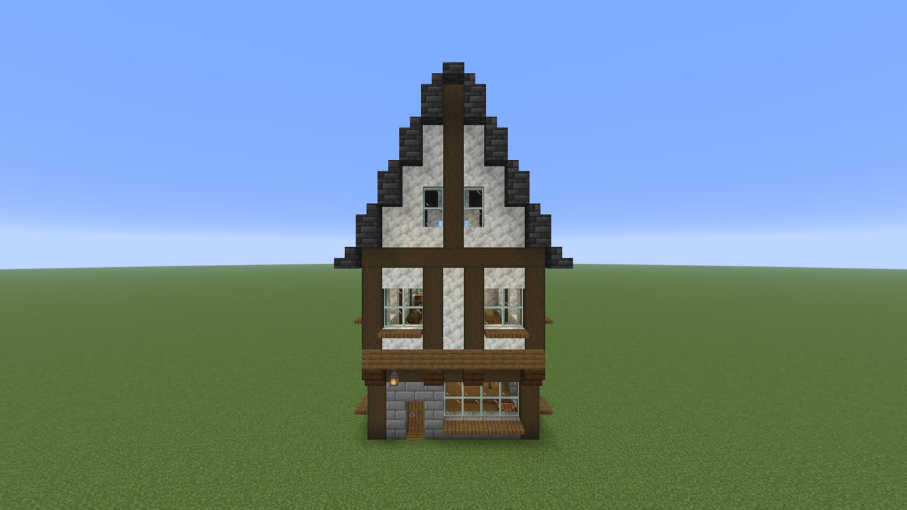
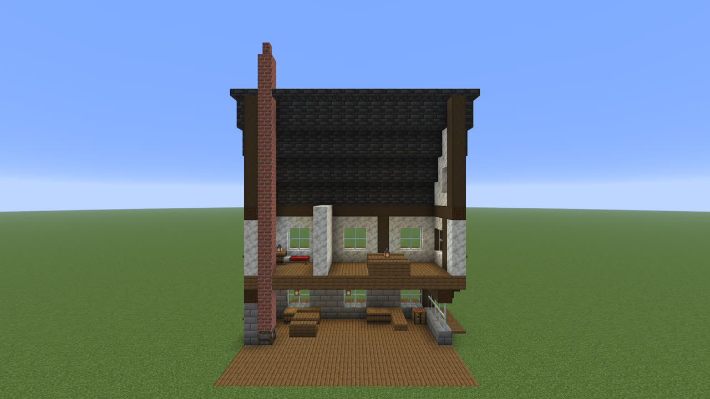

## Standalone cottage

The cottage is single-storey and limewashed, with shuttered windows and a central stack through the ridge. A gabled porch covers the west door. The preset uses the gambrel roof and the L-shaped garden wing. The wing's roof runs into the main roof at a valley, and a garden door sits in its gable end.

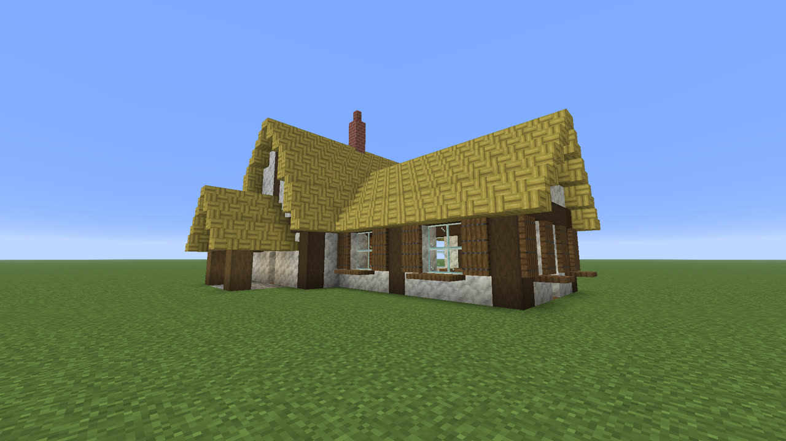
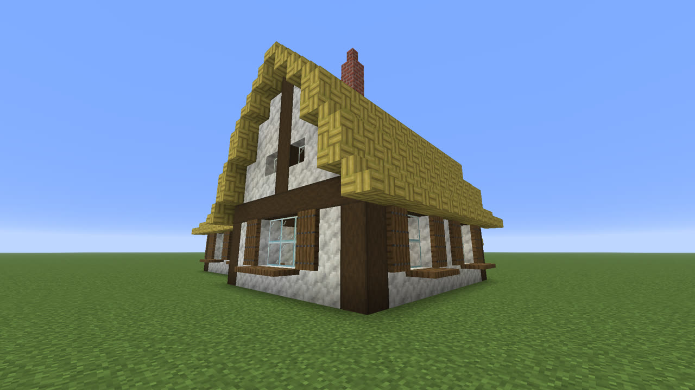
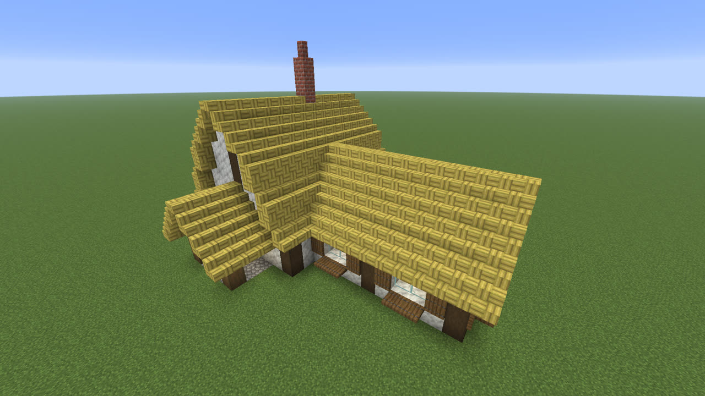

## Farmhouse

The farmhouse has pale oak boards in a dark oak frame. It has a veranda along the street face and a gabled dormer in the hip roof over the door. A lower stone kitchen wing sits behind, with its own stack and yard door. The preset adds the bay-fronted reception room, with a garden door between its two bays. **Storeys** (2 to 4) and **Walls** (pale oak, brick, spruce or birch boards) are farmhouse settings. Flights alternate between the end walls, so each one has full headroom.

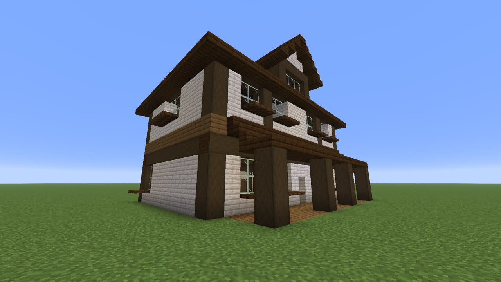
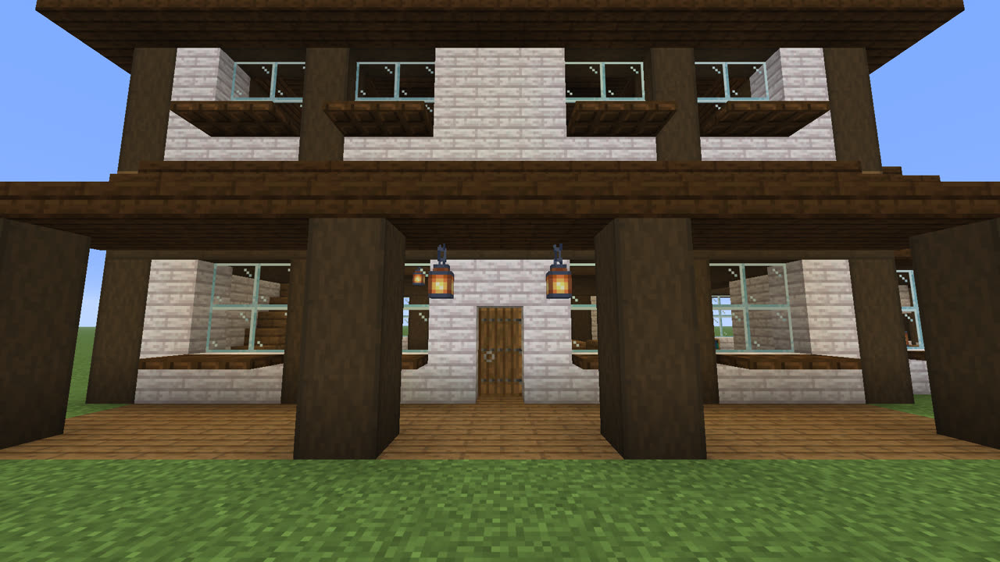
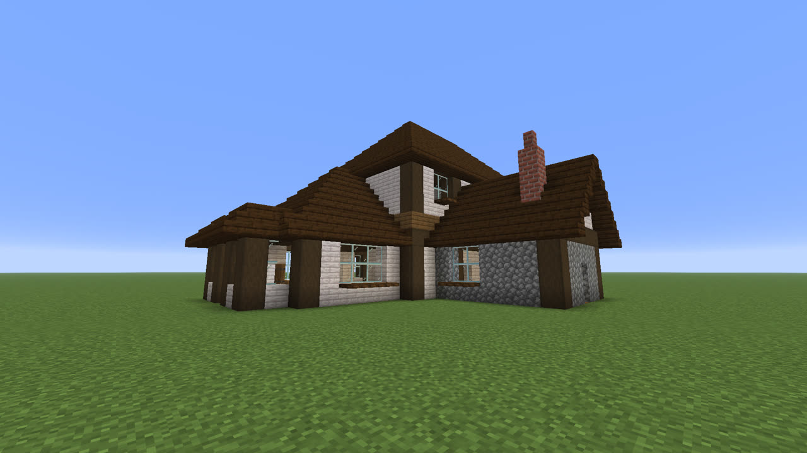
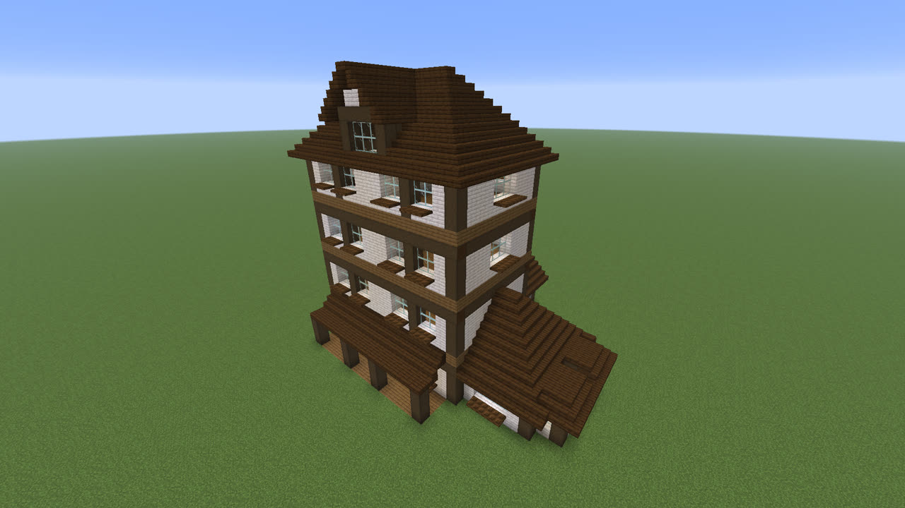
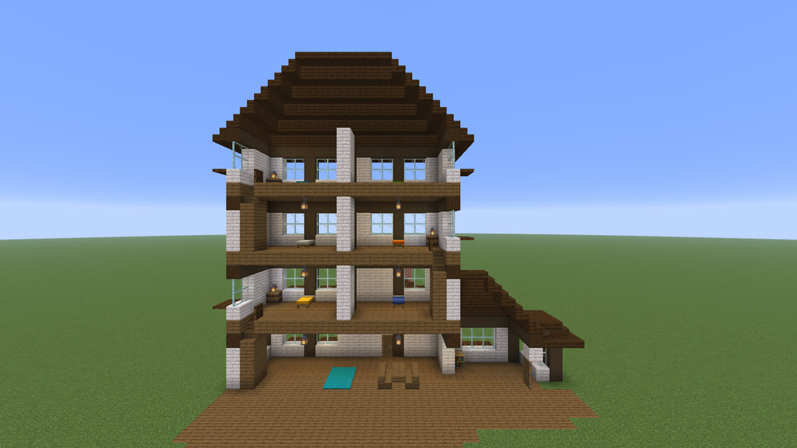

## Other settings

**Main roof** (gable, high-pitched gable, hip, gambrel) and **House plan** (original, L-shaped wing, bay-fronted manor) apply to every house. All the roofs are raised together from one height field, so any combination meets at clean valleys and hips.

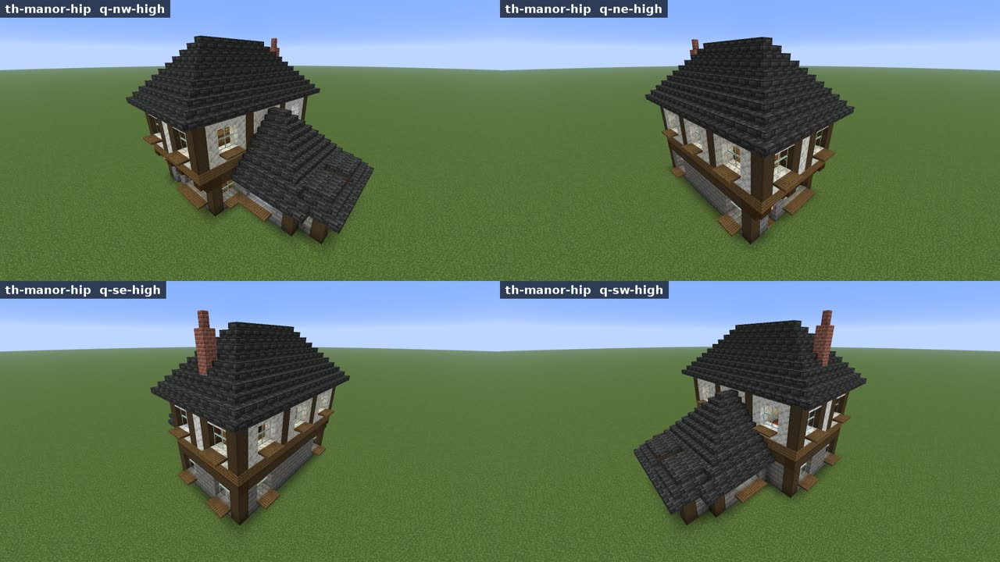
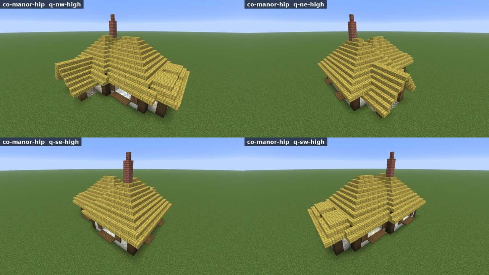
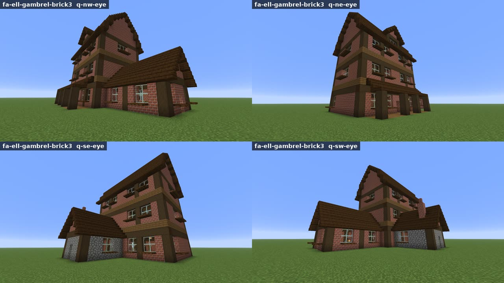

## References

The townhouse follows the end-on, jettied street frontage and side passage recorded at [5 Higher Street, Dartmouth](https://historicengland.org.uk/listing/heritage-gateway/results/record/c39bc47e-3b72-4a06-9863-681629e456a2/MDV8542). The cottage takes its low walls and strong roof silhouette from [White Cottages](https://historicengland.org.uk/listing/the-list/list-entry/1471911). The farmhouse uses the lower kitchen wing documented in the [Pennsylvania agricultural history survey](https://www.pa.gov/content/dam/copapwp-pagov/en/phmc/documents/preservation/pennsylvania-agricultural-history-project/documents/northwestern_woodland.pdf).
