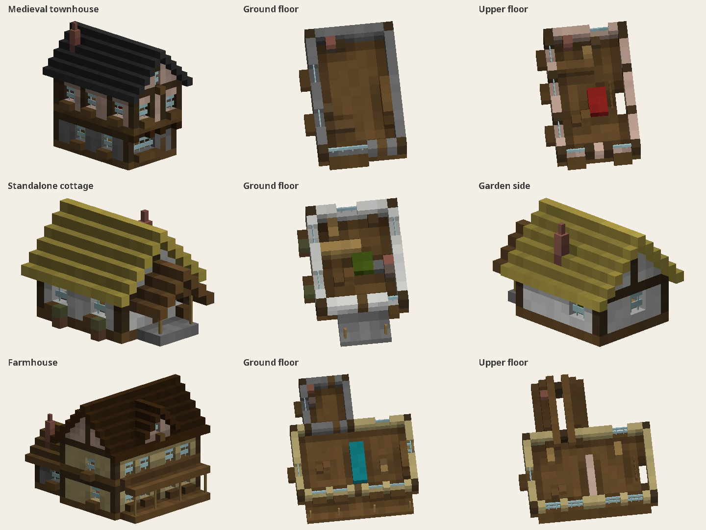

# Houses visual review

Rendered from the finished block volumes with seed 7. Each row shows the entrance and ground floor. The last column shows the upper floor, or the garden elevation for the single-storey cottage. The renderer uses average block colours and approximates furniture shapes.

| Preset | What to look for |
| --- | --- |
| Medieval townhouse | A one-block jetty shades the shop window. Brackets carry the timber front, paired casements light the first-floor hall, and the street door leads past the counter to a side stair. A screen sets the rear bed apart from the table. |
| Standalone cottage | A lower porch sits under the steep straw-coloured roof. A brick stack rises directly over the smoker. The table faces the hearth, with a passage around the timber screen to the sleeping alcove. |
| Farmhouse | The porch follows the long face of the house. A front dormer breaks the roof slope above it. A lower kitchen wing has its own yard door. The central passage connects the parlor, dining table and kitchen, with two sleeping areas upstairs. |

The townhouse follows the end-on, jettied street frontage and side passage recorded at [5 Higher Street, Dartmouth](https://historicengland.org.uk/listing/heritage-gateway/results/record/c39bc47e-3b72-4a06-9863-681629e456a2/MDV8542). The cottage takes its low walls and strong roof silhouette from [White Cottages](https://historicengland.org.uk/listing/the-list/list-entry/1471911). The farmhouse uses the lower kitchen wing documented in the [Pennsylvania agricultural history survey](https://www.pa.gov/content/dam/copapwp-pagov/en/phmc/documents/preservation/pennsylvania-agricultural-history-project/documents/northwestern_woodland.pdf).

Reproduce the sheet with `./gradlew -PcoreOnly :core:reviewHouses`. The PNG is written to `core/build/house-review/`.

## Pending in-game review

In a Minecraft 26.3 client, place each preset from **Houses**. Approach from the street and garden, open the doors, walk to each bed and work surface, and climb and descend both stair flights. Check the cottage porch and farmhouse dormer from eye level, then inspect night lighting, roof joins, furnishings and panes with game textures. Capture exterior and interior screenshots and iterate before marking the PR ready.
