# Sentry tower and bridges review

The sentry has a two-course shell with splayed embrasures, stepped corner piers, an entrance
surround, a level threshold and a projecting corbelled crown. The compact ladder lane and
five-block floor rhythm are retained. Width includes the body; the supports and crown project.

Four independent bridge forms share the castle stone/timber material suites:

| Preset ID | Structure |
| --- | --- |
| `suspensionbridge` | Tapered stone pylons with lit portals, a swept timber cable pair, chain hangers on rail posts and a framed underside |
| `gothicbridge` | Struck pointed arches with face orders and soffit ribs, cutwater piers and parapet refuges; tiers, galleries and other options are in the README |
| `stoneviaduct` | Round arch openings, dressed intrados and continuous cornices |
| `timbertrestle` | Cross-braced timber bents, Warren zigzag side bracing with a mid-height wale, and stone feet |

`bridge_heading=0..15` adds 22.5° per step to the normal player-facing quarter-turn placement.
It is part of the saved settings, so exports and previews use the same heading as placement.
The rasteriser inverse-samples the local structure, avoiding gaps caused by forward rounding.
Directional block states use their nearest available cardinal facing. One-block landing aprons
cover endpoint rounding. Timber rails are a solid knee wall under a plank capping slab, so diagonals have no fence gaps.

`bridge_slope=-25..25` selects a signed percentage grade, with zero preserving a level bridge.
Positive climbs from the starting landing and negative descends. A length of 65 at +25%
raises the far landing by 16 blocks. The deck is quantised to half-block terraces, and the
entire structure follows the grade before heading/placement rotation. The landings and their
aprons stay level with their endpoint. The starting placement datum remains zero. The slope
limit preserves half-block steps at diagonal headings; there are no cardinal-only stair ramps.

Bridge height is support depth below the walking-level origin, and also the suspension pylon
height above it. Place the origin at the bank/deck level. Supports have a fixed depth and do not
sample terrain; place a sufficiently deep bridge over the intended crossing.

## Offline visual evidence

These are average-colour block geometry renders, not Minecraft screenshots.
The baseline uses `Garrison.java` from `f6aa081` with the same seed (7) and preview renderer.

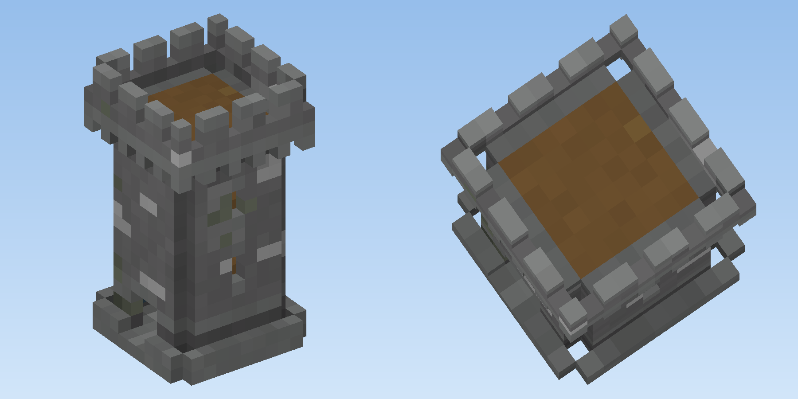
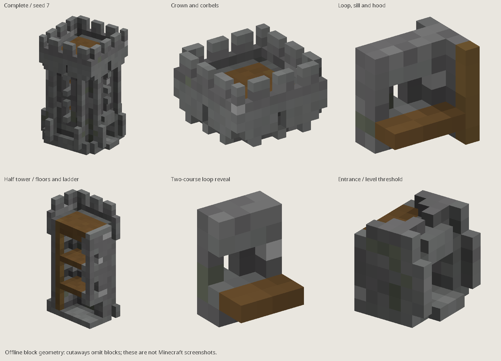
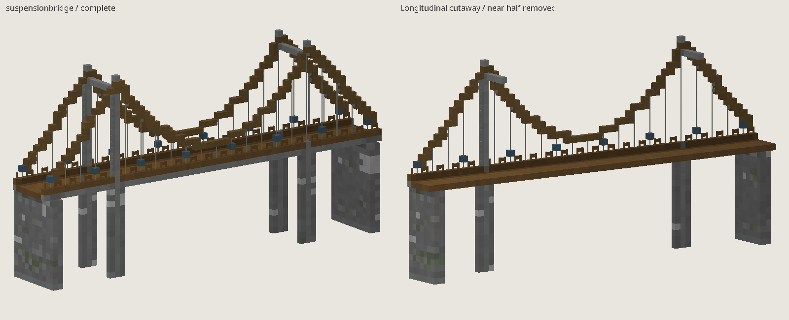
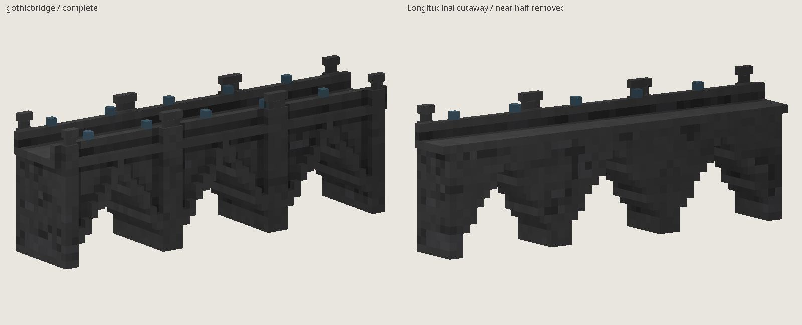
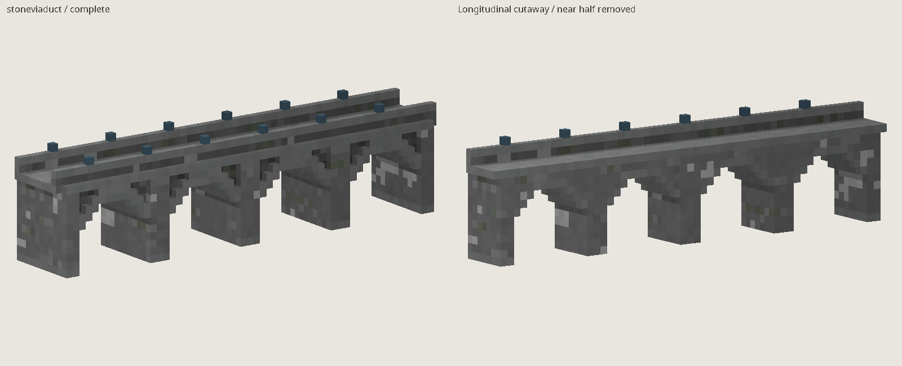
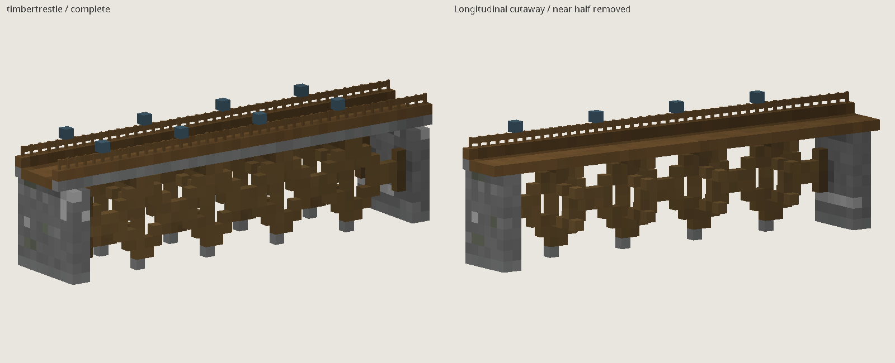


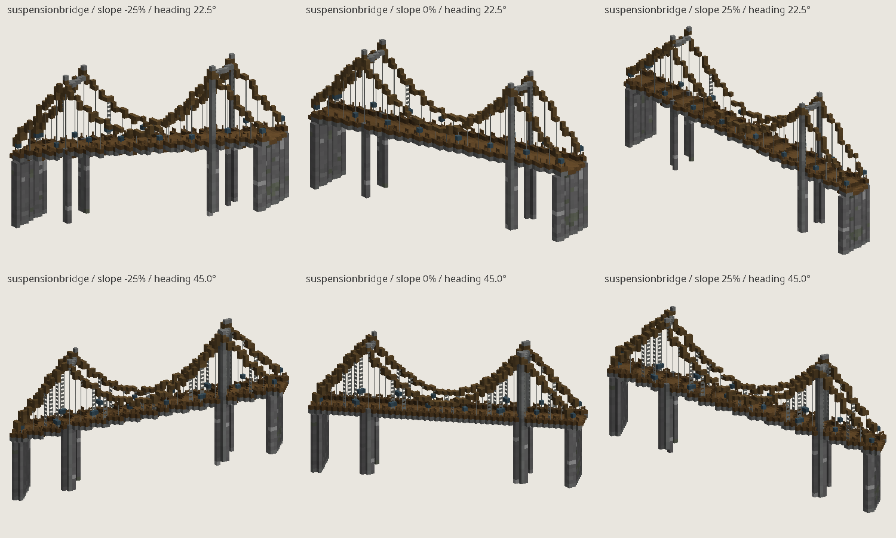
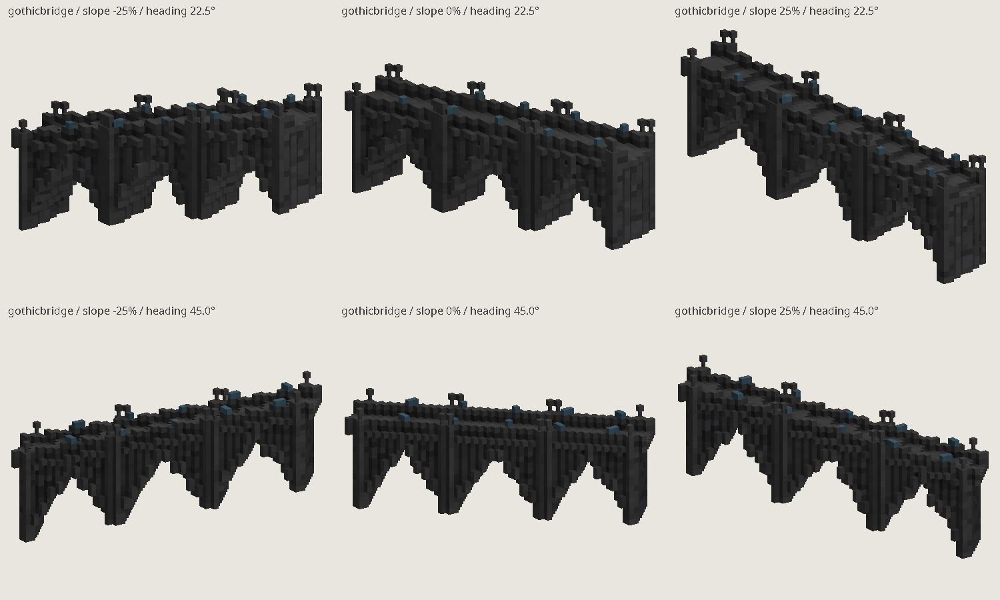
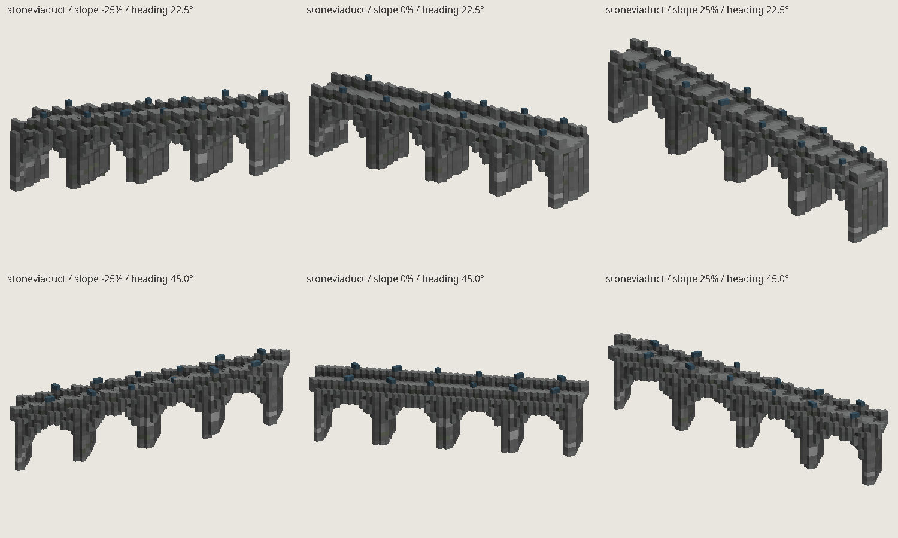
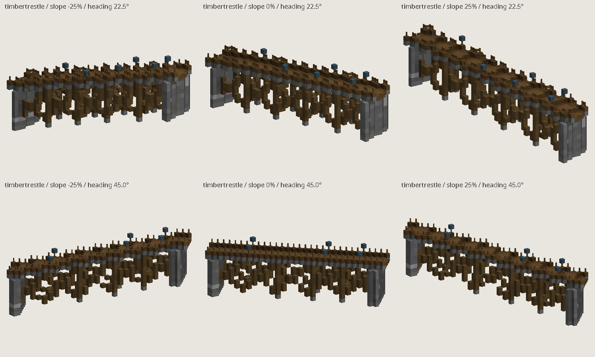

Regenerate the three sentry seeds, four bridge sections, and four sixteen-heading contact sheets, plus uphill/downhill views:

```sh
./gradlew :core:reviewSentryBridges -PcoreOnly
```

The output is `core/build/sentry-bridge-review/`; CI retains these images with the preview artifact.

## Build verification

Verified with JDK 25.0.5, Gradle 9.8.2, Minecraft 26.3, Fabric Loader 0.20.1 and Fabric API
0.165.0+26.3:

```sh
gradle build :core:reviewSentryBridges --offline --no-daemon -Pblockscraper.dir=/tmp/no-block-scraper --max-workers=2
```

The full Fabric build passed. Core tests: 57 passed, one skipped, no failures or errors.
All six server GameTests passed, including all bridge headings and grades -25%, 0% and +25% against the Minecraft registry.
Core bridge tests cover minimum/even-width/maximum dimensions at every heading, connected
landings, reversible half-block traversal on rising/falling decks, supported centreline/headroom, valid state domains, saved headings, placement turn
composition and structure/Sponge export decoding. Sentry tests check reveals, supported sills,
entrance clearance and the existing ladder/exit matrix. Interactive client visuals and collision
checks are still pending below.

## TODO for an agent with an in-game client

- [ ] Launch Minecraft 26.3 with the built Fabric jar; open the generator and expand Bridges.
      Confirm all four presets and Heading (x 22.5°), Slope (%), size, stone and lighting controls work.
- [ ] Place the sentry at widths 7, 8, 9 and 13, heights 8, 17 and 32, seeds 1, 7 and 19.
      Enter from ground level, climb every floor, and step off the ladder onto the fighting deck.
      Repeat with access disabled. Check arrow-loop reveals and the corbel/crown joins up close.
- [ ] Place all four bridge presets at headings 0–15 over a void/valley or water at deck height.
      Walk and sprint end to end; check diagonal landing aprons and two-block headroom.
      Try moving through side rails at shallow/diagonal angles and inspect rail post and chain connections.
- [ ] Repeat every heading at slopes -25%, -7%, 0%, +7% and +25%. Walk both ways without
      jumping; check slab transitions, headroom, diagonal rail joins, level landing aprons, cable
      continuity and arch/trestle joints. Confirm endpoint heights and exported slopes.
- [ ] Check minimum 17×5×5, an even width (8), and maximum 129×17×32 bridges.
      Inspect pylons, cable sweeps, hangers, arch rings, cutwaters and trestle braces from underneath.
      Confirm supports reach the intended ground and explain the fixed-depth control if they do not.
- [ ] Repeat representative 22.5°, 45° and 67.5° bridges in each stone palette with lighting
      none/bright/dim. Inspect actual textures, shadows, lantern support and material transitions.
- [ ] Check placement facing in all four cardinal directions, saved parameter reload, preview
      agreement, undo/redo as supported, and block-for-block preservation of pre-existing terrain on undo.
- [ ] Export diagonal bridges as `.schem`, `.nbt` and Axiom `.bp`; import them in available tools
      and check orientation, walking-level origin and below-deck supports.
- [ ] Attach exterior, player-eye and cutaway screenshots; record Minecraft/Fabric versions,
      preset, seed, sizes, heading and placement facing for every issue. Keep the PR in draft
      until collision and visual checks are reviewed.

## In-game review (Minecraft 26.3 dev client)

Shot with block-scraper in a flat creative world, player facing south, seed 1 unless noted.

Changes made during review:

- **Sentry crown symmetry.** Merlons used an `(x+z) mod 3` rhythm, which formed a pinwheel: only
  two diagonal corners carried merlons and no face mirrored. The machicolation slots (`u%3`) lined up
  only at widths divisible by 3. Both now count from the nearer corner, so every face mirrors at any
  width, all four corners carry merlons, and slots sit directly under the crenels. The stray alternating
  stairs left in the corbel course are gone.
- **Suspension bridge.** Hangers are iron chains rising from log posts in a slab-capped knee-wall rail,
  replacing iron bars that broke the fence rail. No lanterns sit on hangers; lanterns hang under each
  pylon portal and stand on the landing anchor posts, and the Lighting setting still controls them.
  Cables are one block per column rather than doubled steps. The sag bottoms out at about a third of
  the pylon height, clear of head height. Pylons have footings and three-wide legs tapering to a
  capped shaft, with a bracketed portal lintel. The underside has edge girders, cross-beams at every
  hanger and a stone tie between the pylon legs.
- **Gothic bridge.** Openings were straight-sided triangles. They are now equilateral two-centred
  (convex pointed) arches.
- **Timber trestle.** Side X-bracing read as a dense lattice. Each bay now has one diagonal, alternating
  in a Warren zigzag, plus a mid-height wale. Timber rails use a plank capping slab instead of fences.

| | |
| --- | --- |
| 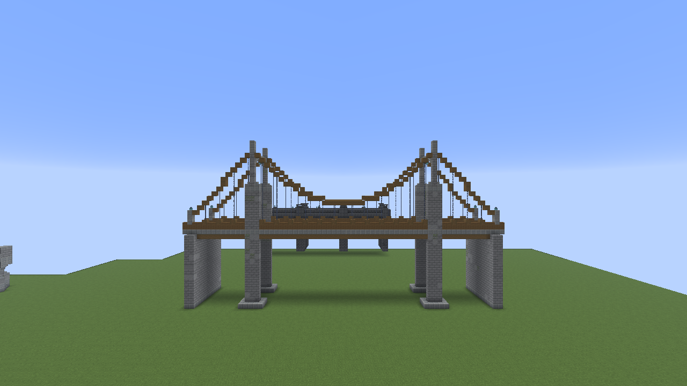 suspension 65×9×16 | 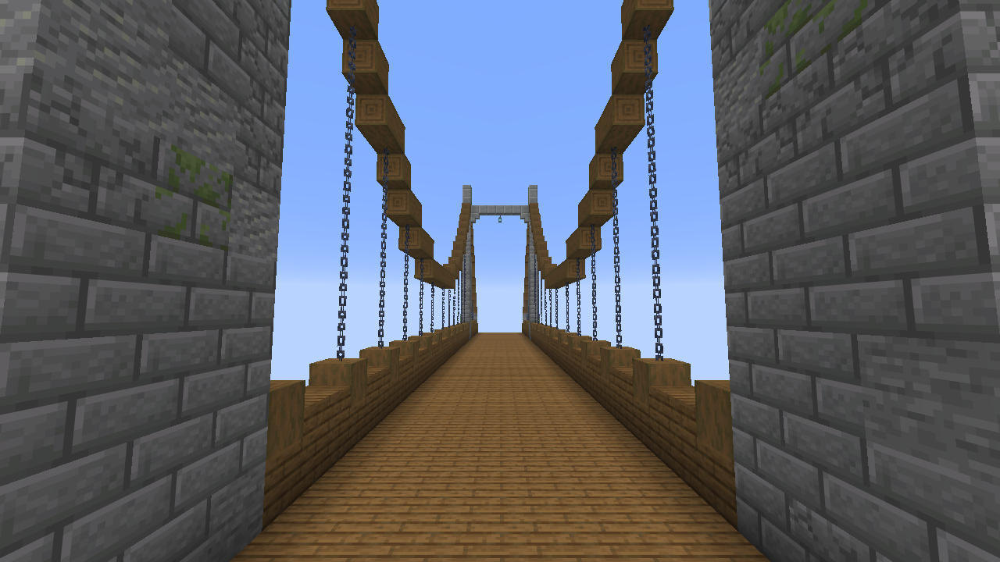 deck at eye level |
| 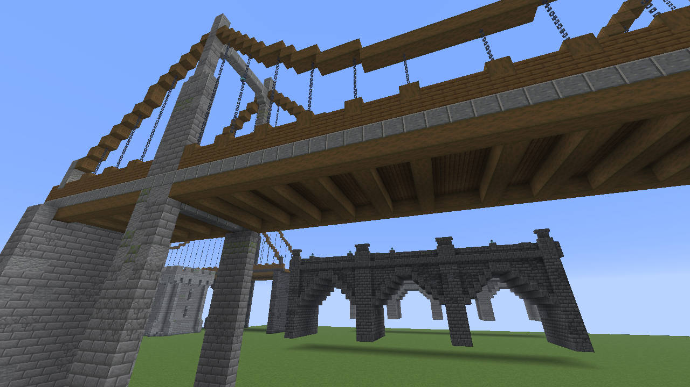 framed underside | 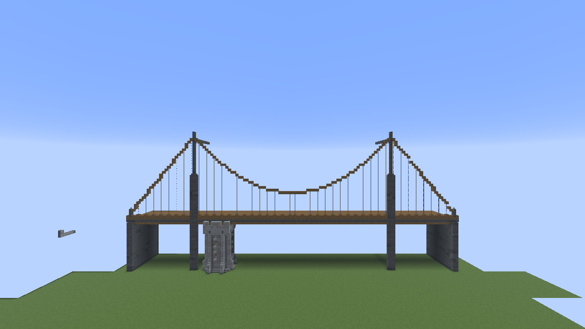 129×17×32 deepslate |
| 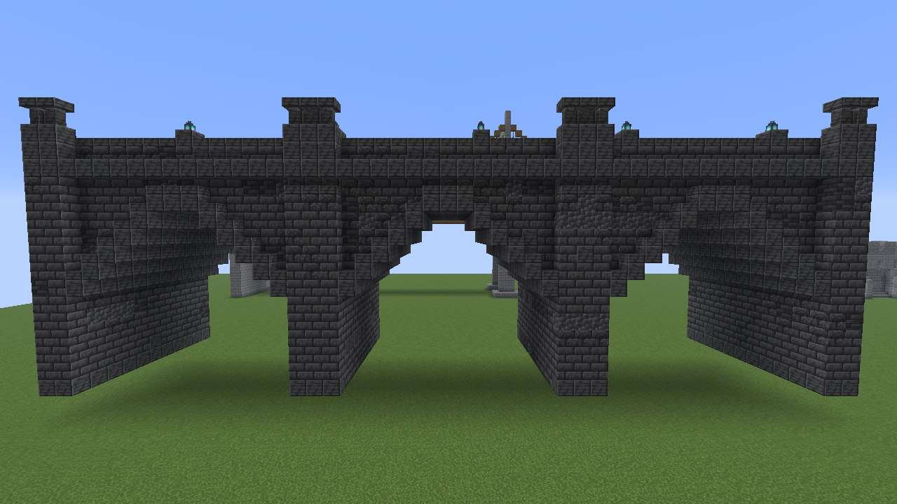 Gothic arches | 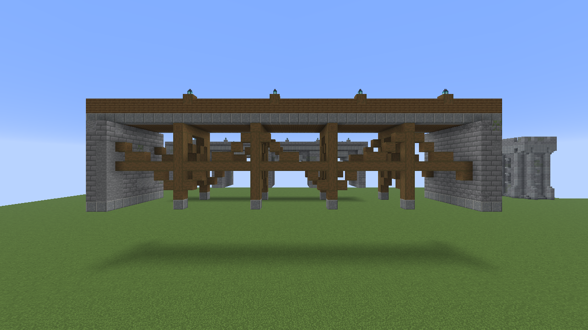 trestle bents and zigzag |
| 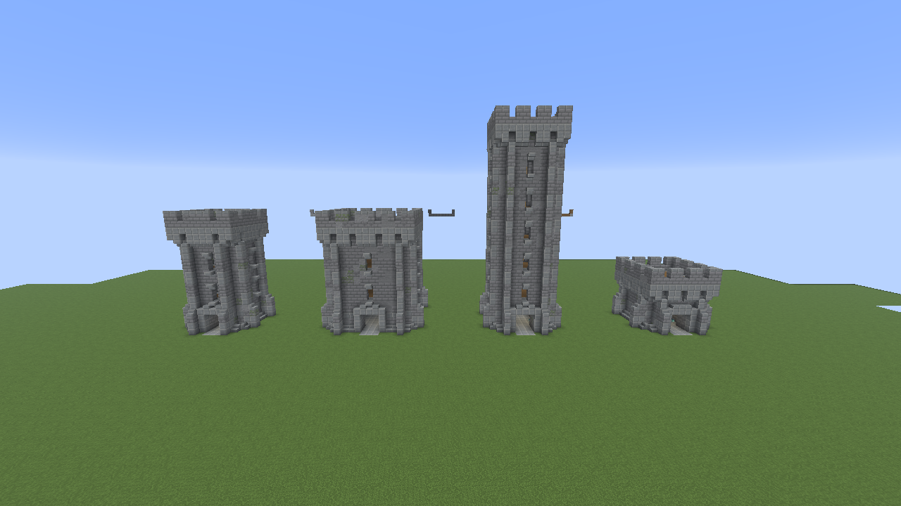 sentries w8/13/9/9, h17/17/32/8 | 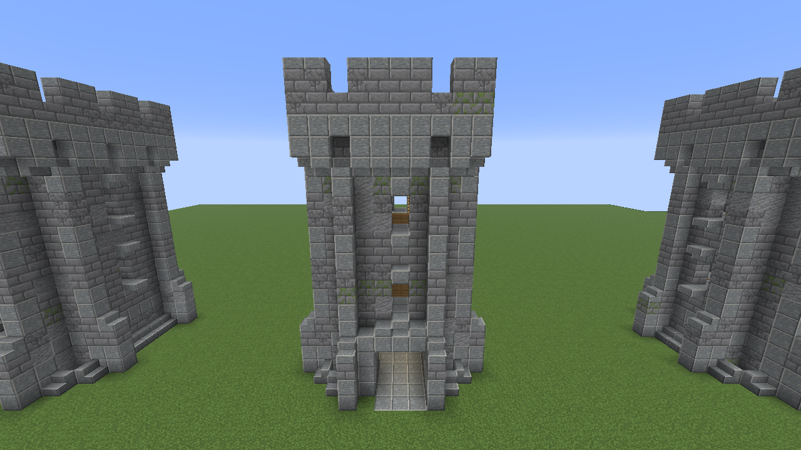 width 8: mirrored crown and slots |
| 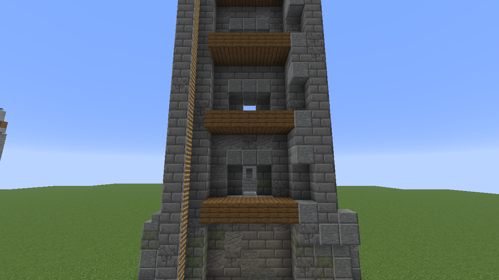 cutaway, h32 seed 7 | 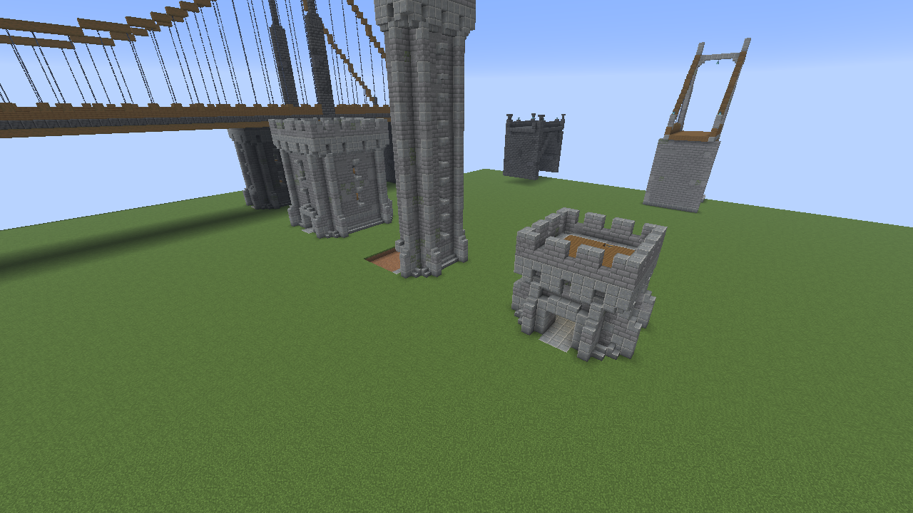 crown from above |

Still open: at even widths, sentry loops and doors sit half a block off-centre, which one-block
openings can't avoid. Diagonal sloped decks show stepped terraces and rails, which comes with grid
rasterisation. Walking/sprinting collision checks, export round-trips and the GUI checklist above
were not repeated in this pass.
